<div align="center">


# BormoStats

**Self-hosted analytics, pricing and automation for Wildberries & Ozon sellers.**<br>
Your sales, money, stock, ads and reviews in one place — on your own server, under your own keys.

[](https://github.com/Bormotoon/BormoStats/actions/workflows/ci.yml)
[](https://github.com/Bormotoon/BormoStats/releases/latest)
[](LICENSE)
[](https://github.com/Bormotoon/BormoStats/commits/main)
<br>
[](https://www.python.org/)
[](https://fastapi.tiangolo.com/)
[](https://react.dev/)
[](https://clickhouse.com/)
[](https://docs.celeryq.dev/)
[](https://redis.io/)
[](infra/docker/docker-compose.yml)
<br>
[](https://www.donationalerts.com/r/bormotoon)
[](https://xn--80abidn3bem.xn--p1ai/projects/bormostats/)
[](CONTRIBUTING.md)

**English** · [Русский](README.ru.md)

[Features](#-features) ·
[Screenshots](#-screenshots) ·
[Quick start](#-quick-start) ·
[Architecture](#-architecture) ·
[API](#-api) ·
[Configuration](#-configuration) ·
[Docs](#-documentation) ·
[Contributing](#-contributing)

🌐 Project page: **[педобраз.рф/projects/bormostats](https://xn--80abidn3bem.xn--p1ai/projects/bormostats/)**

</div>

<br>

<p align="center">
  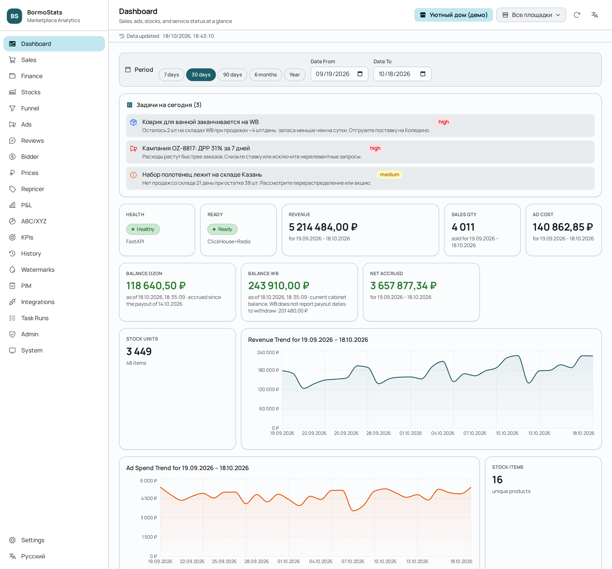
</p>

> [!NOTE]
> Every screenshot in this README shows a **fictional demo shop** generated by
> [`frontend/scripts/readme-screenshots.mjs`](frontend/scripts/readme-screenshots.mjs) against a mocked API.
> No real seller data is shown.

---

## 💡 Why BormoStats

Seller cabinets on Wildberries and Ozon each show a slice of the picture: one report for sales, another
for payouts, a third for ads, and none of them across both marketplaces. Analytics SaaS fixes that by
asking for your API keys and keeping your data on its servers.

BormoStats is the self-hosted alternative. It pulls everything from the **official seller APIs** of your
own accounts into a ClickHouse warehouse on your machine and gives you a web UI, a REST API, BI
dashboards and Telegram alerts on top of it — plus tools that act: a repricer that keeps the price the
buyer sees, an ad bidder, and AI-assisted replies to reviews. Anything that writes to a marketplace
starts in **dry-run** and needs a global switch to go live.

## ✨ Features

<table>
<tr>
<td width="50%" valign="top">

### 📊 Analytics

- **Sales, funnel, stocks, ads** for WB and Ozon in one schema, with per-account filters
- **Finance**: balances, accruals broken down by commission, logistics, storage, penalties, payouts
- **P&L** by month with cost of goods and indirect expenses
- **ABC/XYZ** assortment analysis (revenue share × demand stability)
- **KPIs** over 30 days and an ops **dashboard** with tasks of the day
- **Excel everywhere**: per-column filters, sorting and `.xlsx` export of any table

</td>
<td width="50%" valign="top">

### 🤖 Automation

- **Prices & repricer**: full price breakdown (discounts, commission, logistics, margin, break-even); keep the *buyer* price you set, upload targets from Excel
- **Bidder**: CPM / position rules for WB and Ozon campaigns
- **Reviews**: AI drafts, templates per rating, optional auto-replies to rating-only reviews
- **Insights**: daily anomaly detection → task list and Telegram digest
- **YAML rules engine**: high ACOS, low stock, no sales, stagnant stock… (no `eval`)

</td>
</tr>
<tr>
<td valign="top">

### 🗄️ Data platform

- **Incremental collectors** with watermarks, retries, circuit breaker and secret redaction
- **Three-layer warehouse**: `raw_*` → `stg_*` → `mrt_*` in ClickHouse
- **History store**: git-like archive of every product-card change and ingested row — ask “what was the price on March 3?”
- **Metabase** for ad-hoc SQL and custom dashboards
- **PIM**, **webhooks** (HMAC-signed) and a stock-update endpoint for 1C / МойСклад

</td>
<td valign="top">

### 🛡️ Built for production

- **Multi-tenant**: organizations, roles (`owner` … `viewer`), per-user API keys stored as scrypt hashes
- **Audit log** of every mutating request
- **Hardened containers**: non-root, read-only FS, `no-new-privileges`, TLS-only entry point
- **Prometheus** metrics and alert rules, structured JSON logs
- **Supply chain**: hash-locked deps, digest-pinned images, pip-audit, Grype, SPDX SBOM

</td>
</tr>
</table>

### Project boundaries

- ✅ Collects data from **your own** seller accounts through the official APIs
- ✅ Fully self-hosted — nothing is sent to third parties (the optional AI features call the OpenAI-compatible endpoint *you* configure)
- ✅ Optional competitor tracking covers only the SKUs and keywords you list explicitly
- ❌ No marketplace-wide catalog scraping, no market-share analytics

## 📸 Screenshots

<table>
<tr>
<td width="50%">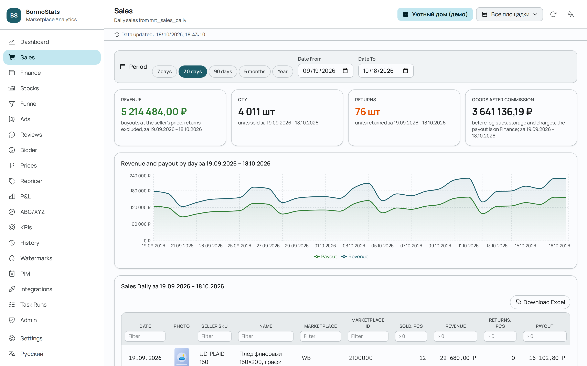<br><sub><b>Sales</b> — revenue, units, returns and payout by day, with a per-product table and Excel export</sub></td>
<td width="50%">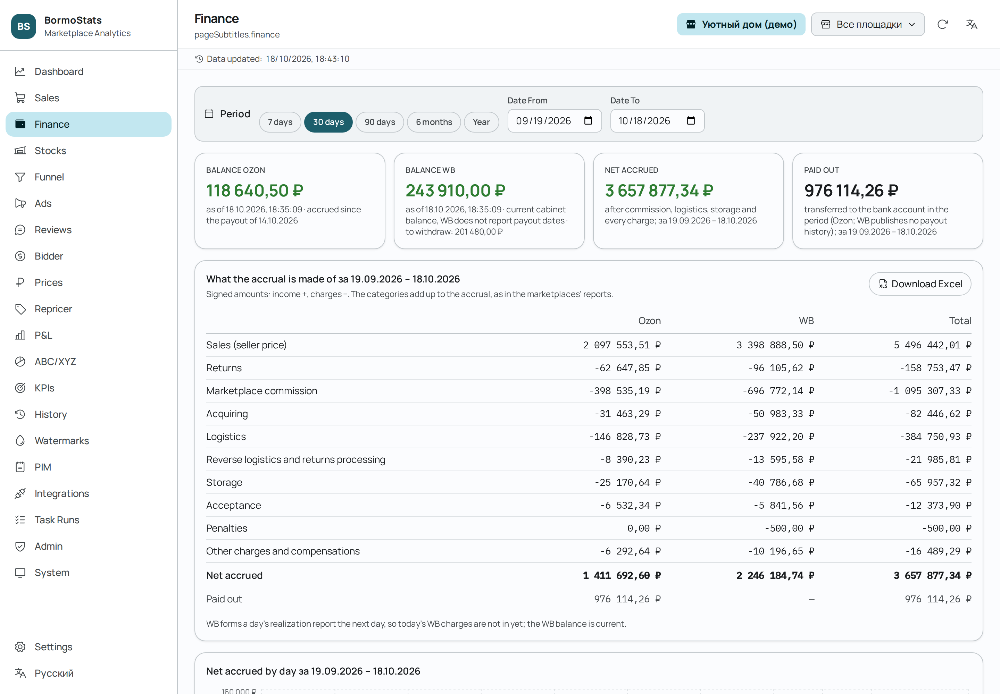<br><sub><b>Finance</b> — balances of both cabinets and how the accrual adds up, item by item</sub></td>
</tr>
<tr>
<td>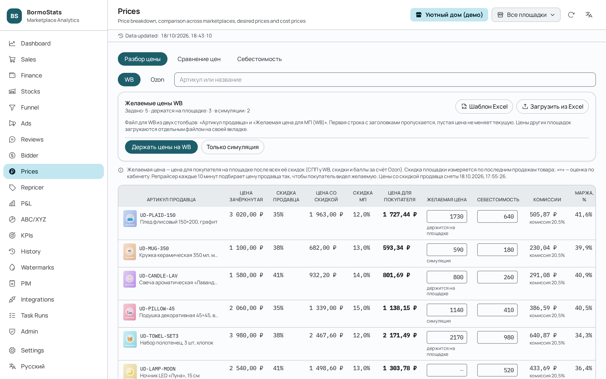<br><sub><b>Prices</b> — from list price to the buyer's price, fees, margin and break-even; desired prices kept by the repricer</sub></td>
<td>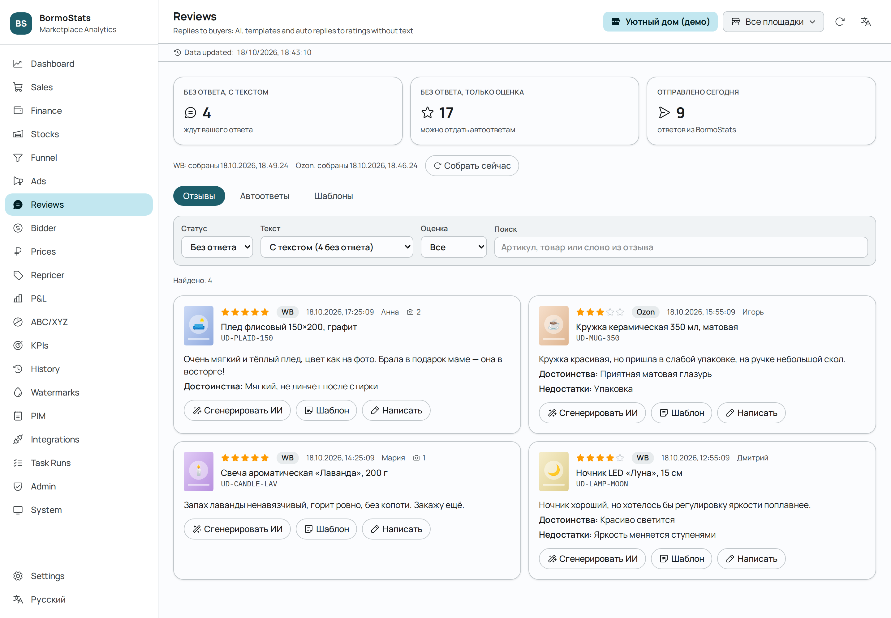<br><sub><b>Reviews</b> — unanswered reviews from both marketplaces, AI drafts, templates and auto-replies</sub></td>
</tr>
<tr>
<td>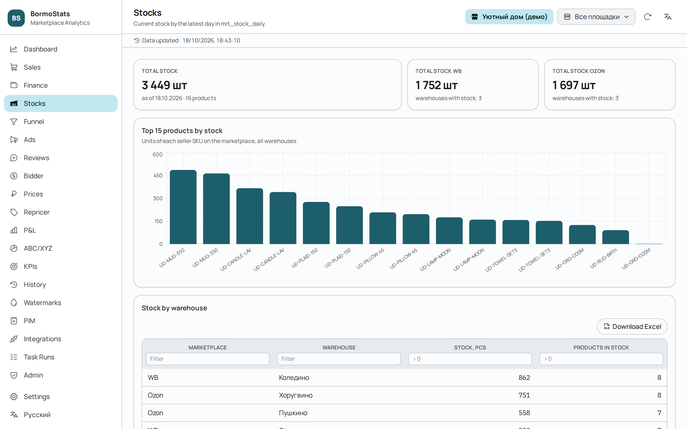<br><sub><b>Stocks</b> — units by warehouse, top products and low-stock highlights</sub></td>
<td>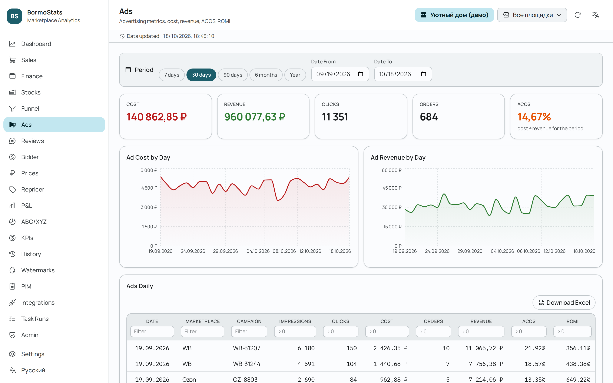<br><sub><b>Ads</b> — spend, ad revenue, clicks, orders, ACOS and ROMI per campaign and day</sub></td>
</tr>
</table>

<details>
<summary><b>More screenshots</b> — funnel, bidder, P&amp;L, ABC/XYZ, KPIs, system</summary>
<br>
<table>
<tr>
<td width="50%">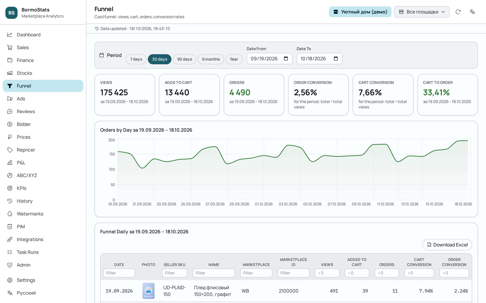<br><sub><b>Funnel</b> — views → cart → orders with conversion rates</sub></td>
<td width="50%">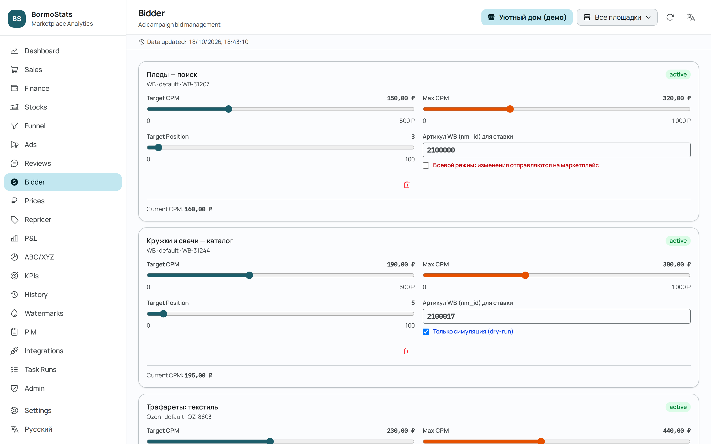<br><sub><b>Bidder</b> — target / max CPM and position per campaign, dry-run toggle and change log</sub></td>
</tr>
<tr>
<td>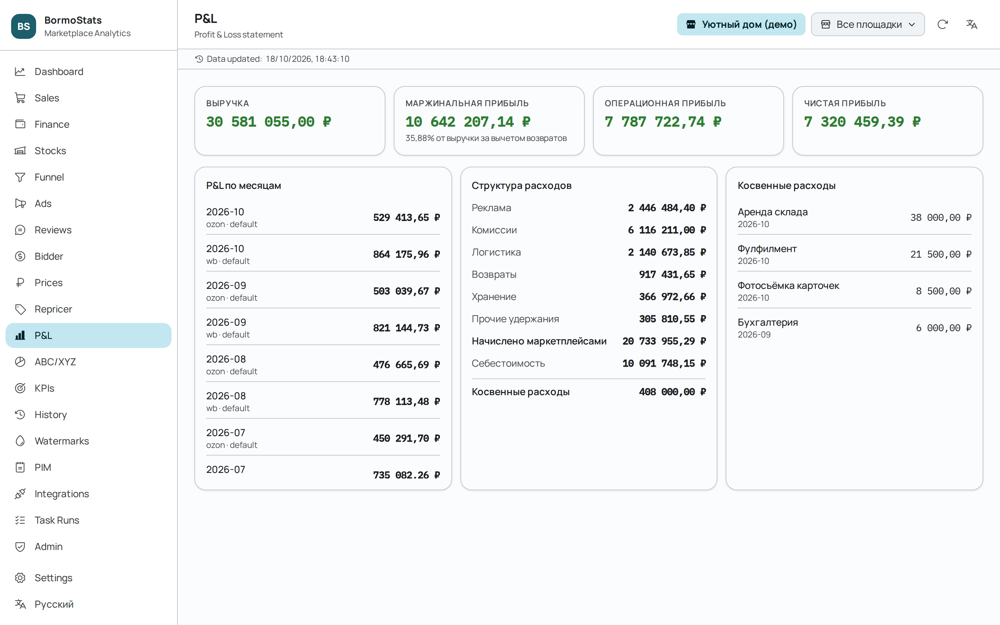<br><sub><b>P&amp;L</b> — gross, operating and net profit with the expense structure</sub></td>
<td>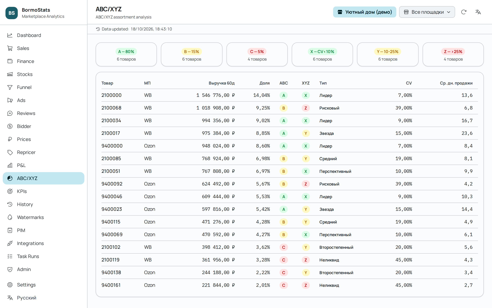<br><sub><b>ABC/XYZ</b> — leaders, stars and illiquid stock at a glance</sub></td>
</tr>
<tr>
<td>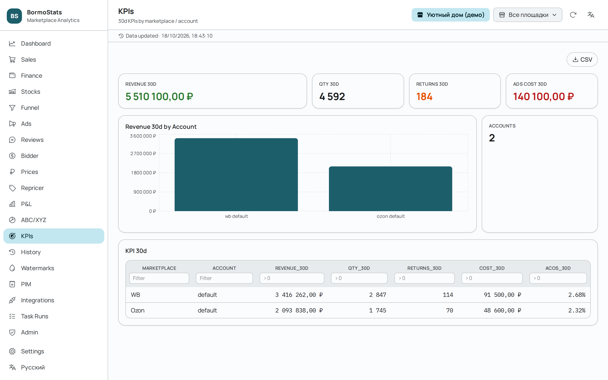<br><sub><b>KPIs</b> — 30-day revenue, units, returns and ad cost per account</sub></td>
<td>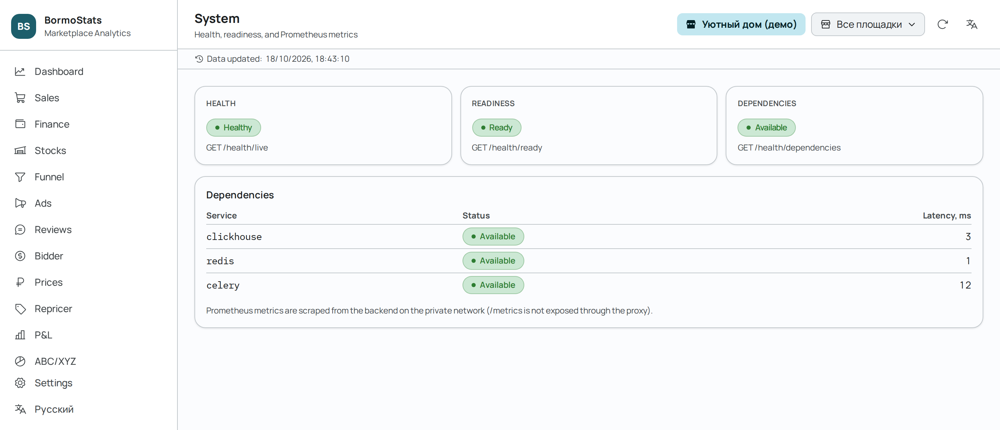<br><sub><b>System</b> — liveness, readiness and dependency latency</sub></td>
</tr>
</table>
</details>

The UI is bilingual (Russian / English) and switches on the fly.

## 🚀 Quick start

**You need:** Docker with Compose v2, `make`, and API tokens of a Wildberries and/or Ozon seller account.

```bash
git clone https://github.com/Bormotoon/BormoStats.git
cd BormoStats
make init ENV=dev        # or ENV=stage / ENV=prod
```

`make init` copies `.env.<env>.example` to `.env` and fills every secret (ClickHouse, Redis, admin key,
webhook and metrics tokens) with strong random values. Add your marketplace tokens to `.env`:

| Variable | Where to get it |
|---|---|
| `WB_TOKEN_STATISTICS`, `WB_TOKEN_ANALYTICS` | WB seller portal → Settings → API access (“Statistics”, “Analytics”) |
| `OZON_CLIENT_ID`, `OZON_API_KEY` | Ozon Seller → Settings → API keys |
| `OZON_PERF_CLIENT_ID`, `OZON_PERF_CLIENT_SECRET` | Ozon ad cabinet → Settings → API *(optional, for ads)* |

Then start the stack:

```bash
make up
```

| What | Where |
|---|---|
| 🖥️ Web UI | <https://localhost:18443/ui/> *(self-signed certificate)* |
| ❤️ Health check | `curl -k https://localhost:18443/health/live` |
| 📈 Metabase | <http://localhost:13000> *(loopback only)* |

> [!TIP]
> The first build takes 3–5 minutes; later builds reuse the Docker layer cache. Data starts flowing on the
> next scheduler tick — use **Admin → Backfill** (or `POST /api/v1/admin/backfill`) to load history right away.

<details>
<summary><b>Run without Docker (bare metal)</b></summary>

Requires **Python 3.14+**, **Node.js 22+**, **ClickHouse** and **Redis** on the host.

```bash
make init ENV=dev
# set the marketplace tokens, point CH_HOST / REDIS_URL at your services
# (clear REDIS_USERNAME if your Redis has no ACL user)
make install   # venv, dependencies, frontend build, migrations
make run       # backend + Celery worker + Celery beat in one terminal
```

For a server, install the bundled systemd units with `sudo make install-systemd`.

</details>

<details>
<summary><b>Useful make targets</b></summary>

| Command | What it does |
|---|---|
| `make up` / `make down` / `make logs` / `make ps` | Manage the Docker stack |
| `make migrate` / `make migrate-status` | Apply / inspect ClickHouse migrations |
| `make backup` / `make restore-check` | Back up ClickHouse; verify a backup restores |
| `make check` | Lint, format check, strict typing, migration manifest and tests |
| `make check-tokens` | Validate marketplace credentials and smoke-check API access |
| `make perf-smoke` | Quick load smoke test of the API |

Run `make help` for the full list.

</details>

## 🧩 Architecture

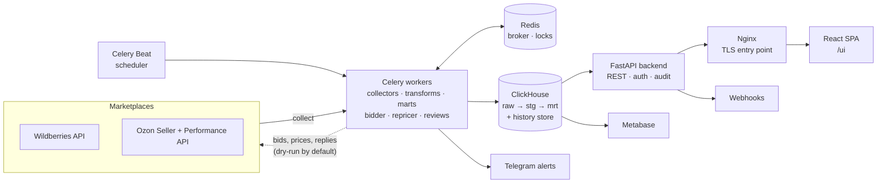

| Component | Technology | Role |
|---|---|---|
| **Backend** | FastAPI, Uvicorn | REST API, web UI, health, metrics |
| **Workers** | Celery 5.6 | Collection, transforms, marts, automation, marketplace actions |
| **Scheduler** | Celery Beat | Periodic tasks |
| **Warehouse** | ClickHouse 26.3 LTS | OLAP storage, marts and the history store |
| **Broker** | Redis 8 | Celery broker and distributed locks |
| **Frontend** | React 19, Vite, Tailwind CSS 4, Recharts | Single-page web UI served under `/ui` |
| **Proxy** | Nginx | The only public entry point, TLS termination |
| **BI** | Metabase | Ad-hoc SQL and dashboards on a read-only user |

**Data flow.** Collectors write raw API responses with normalized keys to `raw_*` tables (idempotent
re-ingestion), transforms build a single cross-marketplace model in `stg_*`, and marts (`mrt_*`) hold the
aggregates the API and dashboards read. Watermarks in `sys_watermarks` make collection incremental, and
`sys_task_runs` keeps an audit of every run. See [docs/architecture.md](docs/architecture.md).

<details>
<summary><b>Repository layout</b></summary>

```text
BormoStats/
├── backend/            FastAPI app: api/v1 routes, services, SQL queries, models
├── workers/            Celery app, beat schedule, tasks, SQL transforms and marts
├── collectors/         WB, Ozon and competitor API clients, parsers, HTTP retry/circuit breaker
├── warehouse/          ClickHouse migrations (with rollbacks) and reference DDL
├── frontend/           React SPA, Playwright E2E tests, README screenshot generator
├── automation/         YAML rules engine and Telegram actions
├── browser_extension/  Competitor overlay for WB / Ozon product pages
├── infra/              Docker Compose, Nginx, ClickHouse, Redis, Prometheus config
├── dashboards/         Metabase / Grafana dashboards
├── scripts/            Bootstrap, backup, backfill and operator utilities
├── tests/              Unit, integration (Docker) and fixture-based tests
└── docs/               Operations, security and design documentation
```

</details>

## 📡 API

Every endpoint lives under `/api/v1` and requires an `X-API-Key` header. The OpenAPI contract is served
to authenticated callers at `/api/v1/openapi.json`.

- **User keys** (`bsk_<id>_<secret>`) are shown once and stored as salted scrypt hashes. The organization
  and role come from the key — a request can never pick another tenant. Keys expire, rotate and revoke.
- **Platform master key** (`ADMIN_API_KEY`) is for operators only: admin operations and cross-tenant work
  via `X-Organization-Id`. Restrict it to your networks with `ADMIN_ALLOWED_NETWORKS`.

```bash
curl -k -H "X-API-Key: $BORMOSTATS_KEY" \
  "https://localhost:18443/api/v1/sales/daily?marketplace=wb&date_from=2026-10-01&date_to=2026-10-18"
```

<details>
<summary><b>Endpoint overview</b></summary>

| Area | Endpoints |
|---|---|
| Analytics | `GET /sales/daily`, `/funnel/daily`, `/ads/daily`, `/stocks/current`, `/kpis`, `/abc-xyz`, `/pnl`, `/freshness` |
| Finance | `GET /finance/daily`, `/finance/balance` |
| Prices | `GET /pricing/breakdown`, `/pricing/compare`; `PUT /pricing/target/{mp}/{offer}`; `POST /pricing/targets/import`, `/pricing/targets/keep`, `/pricing/costs/import` |
| Repricer & bidder | `/repricer/rules`, `/repricer/breakeven`, `/bidder/campaigns`, `/bidder/rules`, `/{bidder,repricer}/actions` |
| Reviews | `GET /reviews`, `/reviews/summary`; `POST /reviews/{mp}/{id}/draft`, `/reviews/{mp}/{id}/reply`; templates and settings |
| History | `GET /history/repos`, `/history/state`, `/history/commits`, `/history/snapshot`, `/history/changes` |
| Insights | `GET /insights/tasks`, `PATCH /insights/tasks/{id}` |
| PIM | `/pim/products`, `/pim/brands`, `/pim/categories`, `POST /pim/products/generate-description` |
| Integrations | `POST /integrations/stock/update`; `/integrations/subscriptions` (CRUD, rotate secret, test); `/integrations/logs` |
| Exports | `POST /exports`, `GET /exports/{id}`, `/exports/{id}/download` |
| Users & orgs | `POST /auth/login`, `/auth/logout`; `GET /users/me`; `/users`, `/users/{id}/rotate-key`, `/revoke-key`; `/organizations`, `/accounts` |
| Admin *(master key)* | `GET /admin/watermarks`, `/admin/task-runs`; `POST /admin/backfill`, `/admin/transforms/*`, `/admin/marts/*`, `/admin/maintenance/*` |

Common query parameters: `marketplace` (`wb` / `ozon`), `account_id`, `date_from` / `date_to`
(up to 92 days), `limit` / `offset`. Errors look like
`{"detail": "...", "error": {"code": "...", "message": "..."}}`.

</details>

> [!IMPORTANT]
> Bidder and repricer rules are created in **dry-run**: changes are simulated and logged only. Going live
> takes both the `execute:marketplace` scope on the rule and `MARKETPLACE_ACTIONS_ENABLED=true` on the
> server. Details in [docs/marketplace_actions.md](docs/marketplace_actions.md).

## 🔧 Configuration

All settings come from `.env`; the annotated templates are [`.env.example`](.env.example) and
`.env.{dev,stage,prod}.example`. `make init` generates every secret for you.

<details>
<summary><b>Marketplace and feature variables</b></summary>

| Variable | Purpose |
|---|---|
| `WB_TOKEN_STATISTICS`, `WB_TOKEN_ANALYTICS` | WB sales, orders, stocks, funnel *(required for WB)* |
| `WB_TOKEN_FINANCE` | WB balance and realization reports (defaults to the statistics token) |
| `WB_TOKEN_MARKETPLACE`, `WB_TOKEN_PRICES`, `WB_TOKEN_PROMOTION` | WB write APIs: stocks, prices, ad bids |
| `WB_TOKEN_CONTENT`, `WB_TOKEN_FEEDBACKS` | Product-card history; reviews and replies |
| `OZON_CLIENT_ID`, `OZON_API_KEY` | Ozon Seller API *(required for Ozon)* |
| `OZON_PERF_CLIENT_ID`, `OZON_PERF_CLIENT_SECRET` | Ozon Performance API (ads) |
| `TG_BOT_TOKEN`, `TG_CHAT_ID` | Telegram alerts and digests |
| `AI_API_URL`, `AI_API_KEY`, `AI_MODEL` | Any OpenAI-compatible endpoint for descriptions and review replies |
| `COMPETITOR_TRACKED_NM_IDS`, `COMPETITOR_TRACKED_OZON_IDS`, `COMPETITOR_TRACKED_KEYWORDS` | Optional competitor tracking |
| `MARKETPLACE_ACTIONS_ENABLED` | Global kill switch for live bid / price changes (default `false`) |
| `HISTORY_ENABLED` | Archive every product-card change and ingested row (default `true`) |

</details>

<details>
<summary><b>Security and operations variables</b></summary>

| Variable | Purpose | Default |
|---|---|---|
| `ADMIN_API_KEY` | Platform master key | generated |
| `ADMIN_ALLOWED_NETWORKS` | CIDRs allowed to use the master key | any |
| `WEBHOOK_SECRET_KEY` | Encrypts webhook signing secrets at rest (AES-GCM) | generated |
| `METRICS_BEARER_TOKEN` | Bearer token required on `/metrics` | generated |
| `CH_RO_USER`, `CH_RO_PASSWORD` | Read-only ClickHouse user for Metabase | — |
| `CH_QUERY_TIMEOUT_SECONDS` | Server-side limit for API queries | `30` |
| `WORKER_CONCURRENCY`, `WORKER_QUEUES` | Worker size and consumed queues | `4` / all |
| `BACKUP_DIR`, `BACKUP_RETENTION_DAYS`, `BACKUP_GPG_RECIPIENT` | `make backup` settings | `./backups` / `14` / — |

</details>

<details>
<summary><b>Default ports</b></summary>

| Service | Port | Exposure |
|---|---|---|
| Nginx HTTP → HTTPS redirect | `18080` | public |
| Nginx HTTPS (UI + API) | `18443` | public |
| Metabase | `13000` | loopback |
| ClickHouse HTTP | `18123` | loopback |
| Worker / Beat metrics | `19101` / `19102` | loopback |

Change the mappings in `.env` if they clash with other services.

</details>

## 🛡️ Security

- Containers run as a non-root user with read-only file systems, `no-new-privileges` and `tmpfs` for `/tmp`.
- Nginx is the only public entry point; ClickHouse, Redis, Metabase and metrics stay on private networks or loopback.
- The application uses a dedicated ClickHouse user, never the bootstrap admin.
- Secrets in logs are redacted; marketplace tokens have documented rotation ([docs/credential_rotation.md](docs/credential_rotation.md)).
- Dependencies are hash-locked, images are pinned by digest, and CI runs `pip-audit`, `npm audit`, Grype and SBOM generation.

Found a vulnerability? Please **don't** open a public issue — report it privately as described in
[SECURITY.md](SECURITY.md).

## 🧪 Development

```bash
python3 -m venv .venv && ./.venv/bin/pip install -r requirements-dev.txt
make init ENV=dev

make lint            # Ruff
make format-check    # Ruff format
make typecheck       # MyPy, strict
make test            # pytest: unit + ClickHouse/Redis integration via Docker
make check-frontend  # npm audit + production build of the web UI
cd frontend && npm run test:e2e   # Playwright E2E smoke tests
```

CI runs the same checks plus Docker image builds, Prometheus alert-rule tests, browser-extension tests and
a supply-chain report on every push.

**Regenerating the README screenshots** — no stack or keys needed, the API is mocked and the browser is
blocked from reaching anything but the local preview server:

```bash
cd frontend && npm run build && npm run screenshots   # → docs/screenshots/{en,ru}/*.png
```

## 📖 Documentation

| Topic | Documents |
|---|---|
| Design | [Architecture](docs/architecture.md) · [Data catalog](docs/data_catalog.md) · [History store](docs/history.md) · [Environments](docs/environments.md) |
| Security | [Authentication](docs/authentication.md) · [Credential rotation](docs/credential_rotation.md) · [Supply chain](docs/supply_chain_security.md) |
| Features | [Marketplace actions](docs/marketplace_actions.md) · [Webhooks](docs/webhooks.md) · [Metabase](docs/metabase.md) |
| Operations | [Runbooks](docs/runbooks.md) · [Troubleshooting](docs/troubleshooting.md) · [Disaster recovery](docs/disaster_recovery.md) · [Observability](docs/observability.md) · [Prometheus](docs/prometheus.md) · [Performance](docs/performance.md) |
| Releases | [Changelog](CHANGELOG.md) · [Release management](docs/release_management.md) · [Migration policy](docs/migration_policy.md) |

## 🤝 Contributing

Contributions are welcome! Please read [CONTRIBUTING.md](CONTRIBUTING.md) first and open an issue before
large changes. Bug reports and feature requests go through the
[issue templates](https://github.com/Bormotoon/BormoStats/issues/new/choose). By taking part you agree to
follow the [Code of Conduct](CODE_OF_CONDUCT.md).

## ❤️ Support the project

BormoStats is free, open source and built in the author's spare time. If it helps your marketplace
business, consider supporting development:

[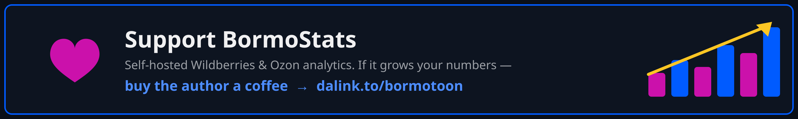](https://www.donationalerts.com/r/bormotoon)

A ⭐ on GitHub helps too — it makes the project easier for other sellers to find.

## 📜 License

BormoStats is licensed under the [GNU General Public License v3.0](LICENSE). You may use, study, modify
and share it; distributed modified versions must be released under the same license.

Wildberries and Ozon are trademarks of their respective owners. BormoStats is an independent project and
is not affiliated with or endorsed by either marketplace.

---

<div align="center">

Made with ❤️ for marketplace sellers who want to own their data.

[🌐 Project page](https://xn--80abidn3bem.xn--p1ai/projects/bormostats/) ·
[🐛 Report a bug](https://github.com/Bormotoon/BormoStats/issues/new/choose) ·
[💬 Request a feature](https://github.com/Bormotoon/BormoStats/issues/new/choose) ·
[☕ Donate](https://www.donationalerts.com/r/bormotoon)

</div>
