<div align="center">


# BormoStats

**Self-hosted analytics, SKU unit economics, pricing and automation for Wildberries, Ozon & Yandex Market sellers.**<br>
Your sales, unit economics, money, taxes, stock, ads and reviews in one place — on your own server, under your own keys.

[](https://github.com/Bormotoon/BormoStats/actions/workflows/ci.yml)
[](https://github.com/Bormotoon/BormoStats/releases/latest)
[](LICENSE)
[](https://github.com/Bormotoon/BormoStats/commits/main)
<br>
[](https://www.python.org/)
[](https://fastapi.tiangolo.com/)
[](https://react.dev/)
[](https://clickhouse.com/)
[](https://docs.celeryq.dev/)
[](https://redis.io/)
[](infra/docker/docker-compose.yml)
<br>
[](https://www.donationalerts.com/r/bormotoon)
[](https://xn--80abidn3bem.xn--p1ai/projects/bormostats/)
[](CONTRIBUTING.md)

**English** · [Русский](README.ru.md)

[Features](#-features) ·
[Screenshots](#-screenshots) ·
[Quick start](#-quick-start) ·
[Architecture](#-architecture) ·
[API](#-api) ·
[Configuration](#-configuration) ·
[Security](#-security) ·
[Docs](#-documentation) ·
[Contributing](#-contributing)

🌐 Project page: **[педобраз.рф/projects/bormostats](https://xn--80abidn3bem.xn--p1ai/projects/bormostats/)**

</div>

<br>

<p align="center">
  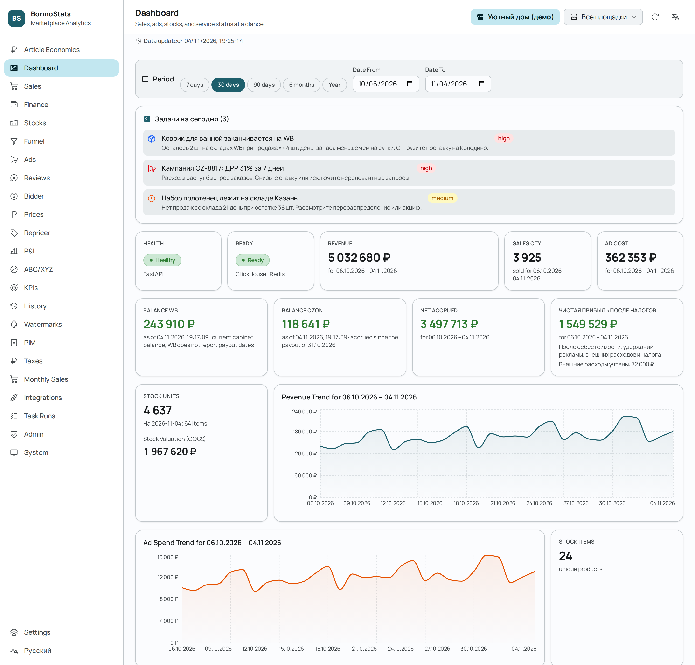
</p>

> [!NOTE]
> Every screenshot in this README shows a **fictional demo shop** across Wildberries, Ozon, and Yandex Market generated by
> [`frontend/scripts/readme-screenshots.mjs`](frontend/scripts/readme-screenshots.mjs) against a mocked API.
> No real seller data is shown.

---

## 💡 Why BormoStats

Seller cabinets on Wildberries, Ozon, and Yandex Market each show a slice of the picture: one report for sales, another
for payouts and realization, a third for ads, and none of them reconcile unit economics across all three marketplaces.
Cloud analytics SaaS platforms solve that by asking for your API keys and storing your commercial data on their servers.

BormoStats is the **self-hosted alternative**. It pulls everything from the **official seller APIs** of your
own accounts into a ClickHouse warehouse on your machine and gives you a fast React 19 web UI, a REST API, BI
dashboards, and Telegram alerts — plus autonomous tools that act: a smart repricer that keeps the price the
buyer sees (while respecting Ozon's price index and promotion limits), an ad bidder, and AI-assisted replies to reviews.
Every marketplace write action uses a **two-phase commit ledger** (`pending` → `applied` → `confirmed` via read-after-write reconciliation),
starts in **dry-run**, and requires an explicit global switch (`MARKETPLACE_ACTIONS_ENABLED=true`) to go live.

## ✨ Features

<table>
<tr>
<td width="50%" valign="top">

### 📊 Multi-Marketplace Analytics & Finance

- **Three marketplaces in one model**: **Wildberries**, **Ozon**, and **Yandex Market** with per-account and cross-marketplace filtering
- **Article Unit Economics (`/#/economics`)**: $O(N + S)$ streaming engine with **66 expandable columns** (16-column compact vs. 66-column full Excel-style view, custom column picker, domestic RF vs. EAEU/CIS buyouts, SKU-linked ads, unallocated expenses row, realization tax, operating & net profit, ROI, and ABC class)
- **Universal Funnel & Cohort Economics (`/#/funnel`)**: 50+ funnel, ad (Auto vs. CPC), stock turnover, 90-day buyout rate, and unit-economics forecast metrics, plus manual `.xlsx`/`.csv` funnel report import
- **Finance & Historical Valuation (`as_of`)**: cabinet balances, daily accruals broken down by commission, acquiring, logistics, reverse logistics, storage, acceptance, penalties, and payouts; point-in-time stock and COGS valuation (`as_of`)
- **Daily & Monthly P&L + Realization Taxes (`/#/pnl`, `/#/taxes`)**: dated and monthly indirect expenses, Ozon factoring adjustments, realization tax calculation (`confirmed` closed reports vs. `estimated` open days), USN 6% + 1% over 300k RUB calculator, and monthly sales summary
- **ABC/XYZ** assortment matrix (revenue share × weekly demand stability) & **30-day KPIs**
- **Excel everywhere**: per-column filters (`> 100`, `10-20`), sorting, and instant `.xlsx` export of any table

</td>
<td width="50%" valign="top">

### 🤖 Smart Automation & Operations

- **Prices & Smart Repricer (`/#/pricing`, `/#/repricer`)**:
  - Full price breakdown: list price, seller discount, marketplace discount (WB SPP, Ozon co-financed points, YM co-financing), buyer price, fees, COGS, margin, and break-even
  - Keeps the **buyer price** you set; 2-column Excel template & bulk import with "uploaded from file" badges
  - **Ozon Price Index & Limit Price**: automatically steps down when Ozon's price index turns `RED`, holds on `YELLOW`, and syncs `min_price` so auto-promotions cannot sell cards at deep unauthorized discounts
  - **No-sales fallback**: price new cards as `seller_price` or `account_median` until their first sale
  - **WB Safety Documents Check**: warns when any WB card is missing the "safety documents not required" tick
- **Ad Bidder (`/#/bidder`)**: CPM / bid rules for WB, Ozon, and Yandex Market campaigns with two-phase action verification
- **Reviews (`/#/reviews`)**: unanswered reviews across WB, Ozon, and YM, AI reply drafts, rating templates (`{имя}`, `{товар}`), and optional auto-replies to rating-only reviews
- **Actionable Insights & YAML Rules**: daily anomaly detection (low turnover, high ACOS, stagnant stock) → dashboard tasks and morning Telegram digest (no `eval`)

</td>
</tr>
<tr>
<td valign="top">

### 🗄️ Data Platform & Integrations

- **Incremental collectors** with watermarks (`sys_watermarks`), exponential retries, circuit breaker, and secret redaction across `wb`, `ozon`, and `ym` Celery queues
- **Three-layer ClickHouse warehouse**: `raw_*` → `stg_*` → `mrt_*` (51 versioned migrations with verified rollback scripts)
- **Git-like History Store (`/#/history`)**: append-only archive (`hist_objects`, `hist_commits`, `hist_refs`, `hist_changes`) of every product-card snapshot and every ingested raw row — inspect the exact state of any card or report at any Moscow timestamp
- **PIM (`/#/pim`)**: product catalog, brands, categories, inline editing, and AI SEO description generator for WB, Ozon, and YM
- **Integrations (`/#/integrations`)**: unified stock push endpoint (`POST /api/v1/integrations/stock/update`) for 1C / МойСклад (supporting YM `grouped` and `partner` warehouse modes) and HMAC-signed webhooks
- **Browser Extension**: client-side competitor price and keyword SERP position overlay on WB, Ozon, and Yandex Market product pages
- **Metabase**: ad-hoc SQL and custom BI dashboards under a read-only ClickHouse user

</td>
<td valign="top">

### 🛡️ Hardened for Production

- **Multi-tenant RBAC**: organizations, roles (`owner`, `admin`, `manager`, `analyst`, `viewer`), and per-user API keys (`bsk_…`) stored as salted `scrypt` hashes
- **Cost & Finance Isolation**: strict `ManagerAuth` masking of procurement costs (`cost_price_rub`), unit economics, and financial overlays in both API responses, CSV exports, and Redis query cache keys
- **Session Coherence**: password changes, admin resets, and member updates immediately revoke active sessions and flush the in-memory auth cache
- **Defensive Security**: HTTP security headers (`CSP`, `HSTS`, `X-Frame-Options`, `nosniff`), `.xlsx` zip-bomb & buffer-overflow guards, CSV formula-injection neutralization, SQL path-traversal bounds checks, and frontend image URL scheme sanitization
- **Hardened Containers & Local Assets**: non-root, read-only rootfs, `no-new-privileges`, TLS-only Nginx entry point, and self-hosted fonts (`Manrope`, `IBM Plex Mono`) with zero external font calls
- **Supply Chain**: hash-locked Python/Node deps, digest-pinned Docker images, `pip-audit`, `npm audit`, Grype, and SPDX SBOM in CI

</td>
</tr>
</table>

### Project boundaries

- ✅ Collects data from **your own** seller accounts through the official Wildberries, Ozon, and Yandex Market APIs
- ✅ Fully self-hosted — nothing is sent to third parties (optional AI features call the OpenAI-compatible endpoint *you* configure; fonts and assets are served locally)
- ✅ Optional competitor tracking covers only the SKUs and search keywords you list explicitly
- ❌ No marketplace-wide catalog scraping, no proxy farms, no market-share harvesting

## 📸 Screenshots

<table>
<tr>
<td width="50%">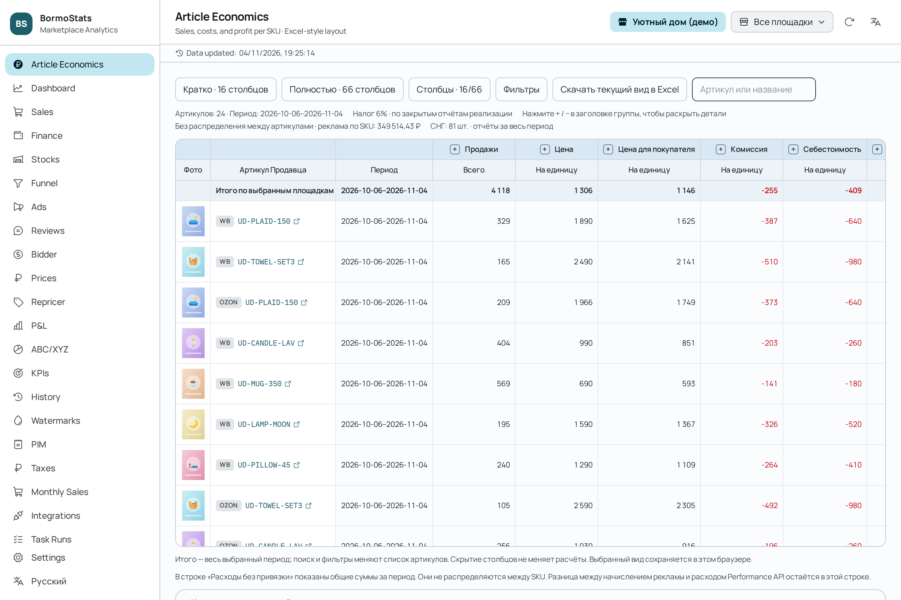<br><sub><b>Article Unit Economics</b> — 66 expandable columns per SKU across WB, Ozon, and YM: revenue, RF/CIS buyouts, fees, SKU ads, COGS, taxes, net profit, and ROI</sub></td>
<td width="50%">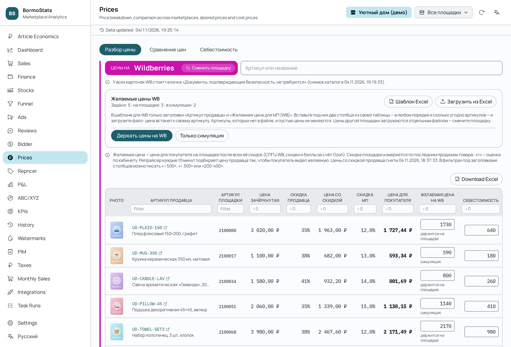<br><sub><b>Prices &amp; Repricer</b> — list price to buyer price breakdown, WB safety-document check, Excel template/import, and live/dry-run repricer status</sub></td>
</tr>
<tr>
<td>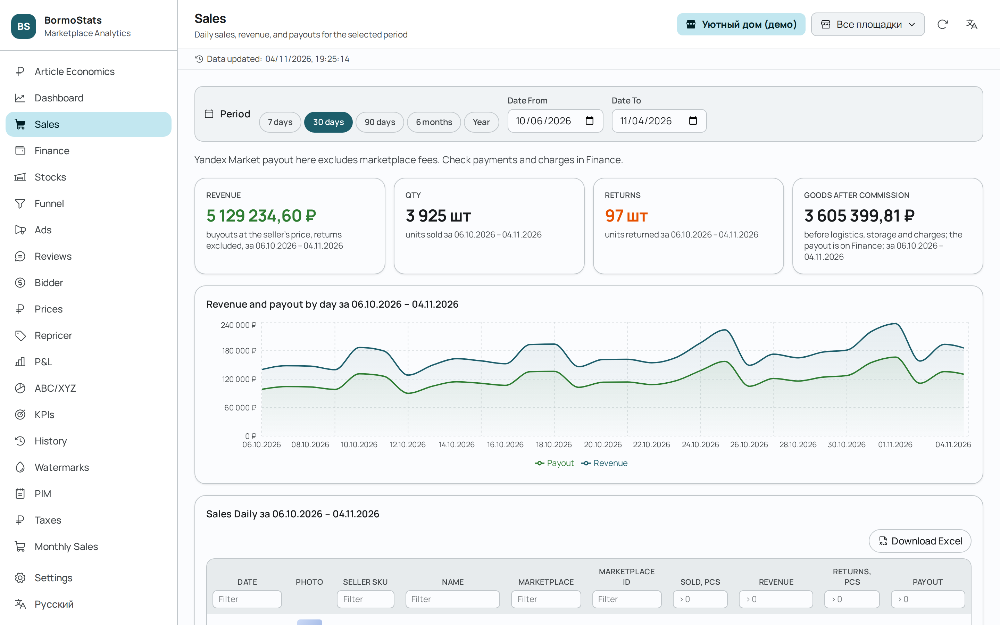<br><sub><b>Sales</b> — daily revenue, units, returns, and goods after commission across WB, Ozon, and Yandex Market with Excel export</sub></td>
<td>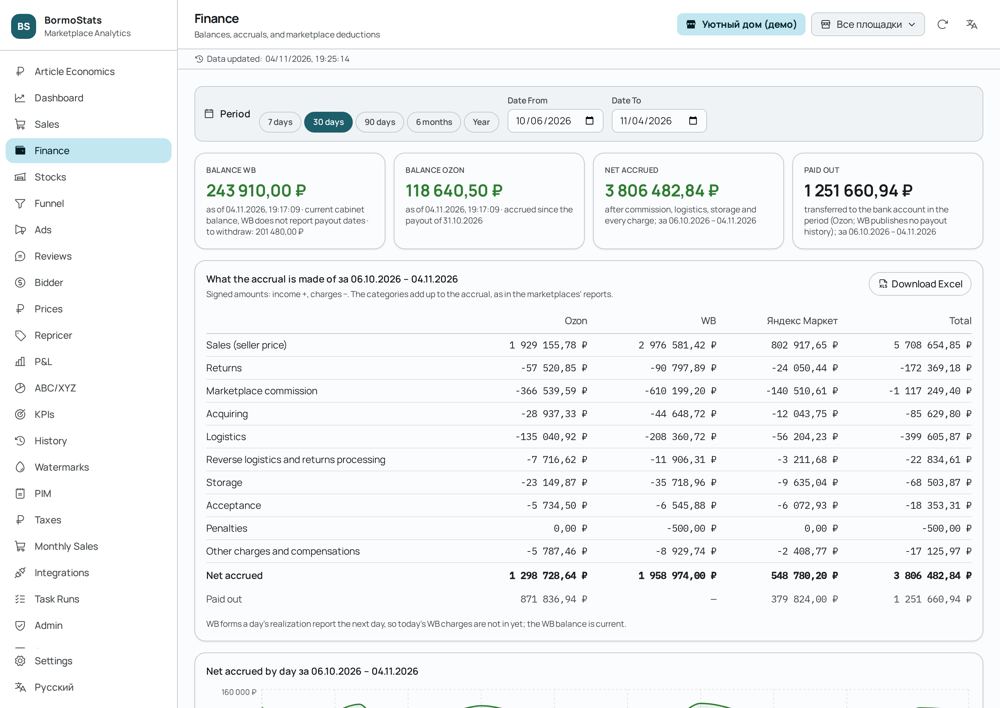<br><sub><b>Finance</b> — cabinet balances and item-by-item accrual breakdown across all connected marketplaces</sub></td>
</tr>
<tr>
<td>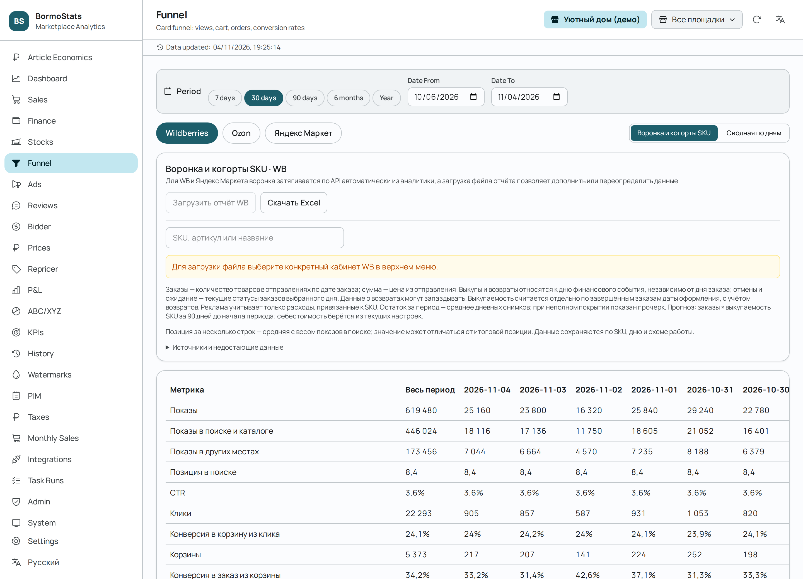<br><sub><b>Funnel &amp; SKU Cohorts</b> — 50+ cohort metrics, 90-day buyout rate, unit-economics forecast, and Excel funnel report import for WB, Ozon, and YM</sub></td>
<td>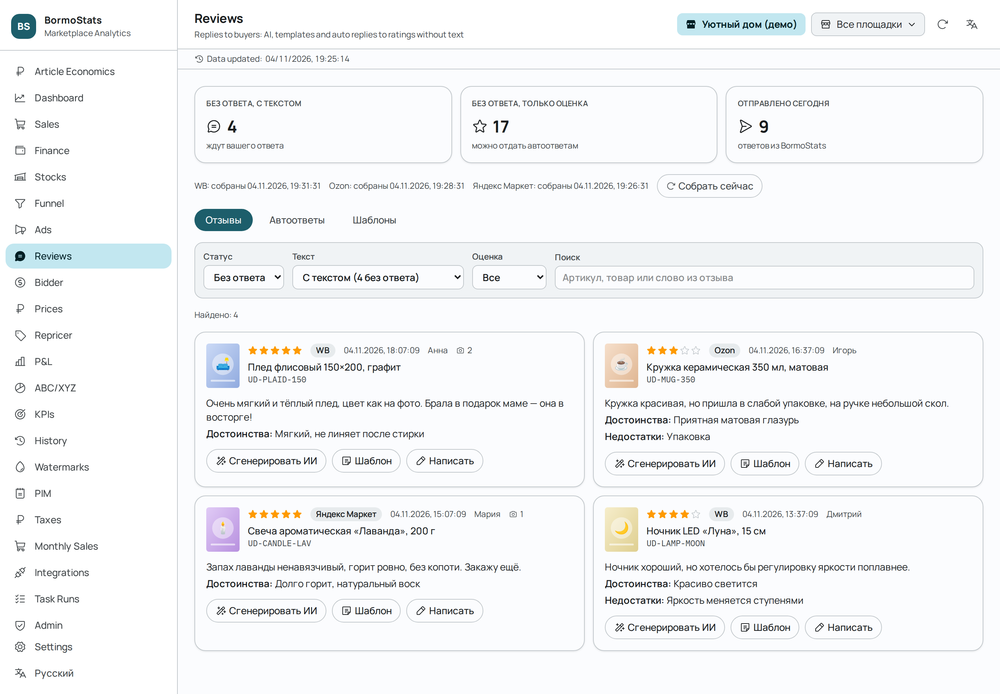<br><sub><b>Reviews</b> — unanswered reviews from WB, Ozon, and YM, AI reply drafts, rating templates, and auto-replies</sub></td>
</tr>
<tr>
<td>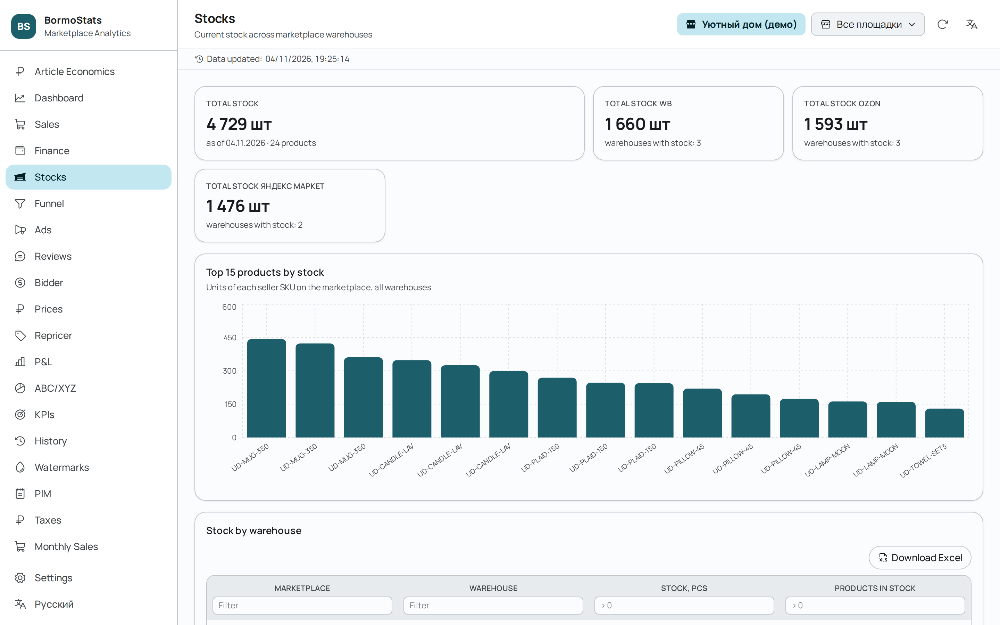<br><sub><b>Stocks</b> — inventory by marketplace and warehouse, top products, and low-stock highlights</sub></td>
<td>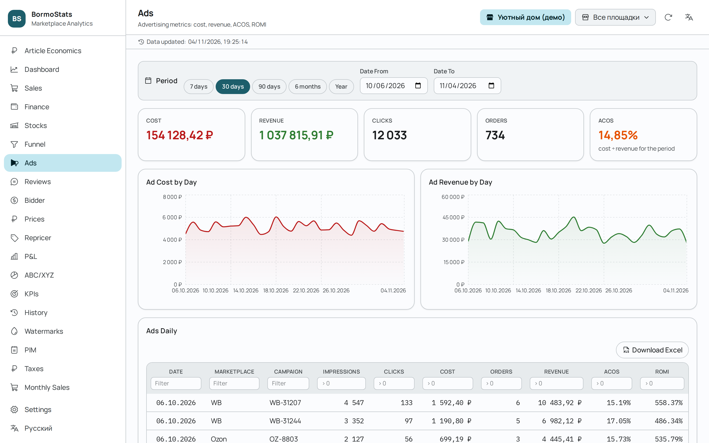<br><sub><b>Ads</b> — spend, ad revenue, clicks, orders, ACOS, and ROMI per campaign and day</sub></td>
</tr>
</table>

<details>
<summary><b>More screenshots</b> — P&amp;L, Taxes, Bidder, ABC/XYZ, KPIs, System</summary>
<br>
<table>
<tr>
<td width="50%">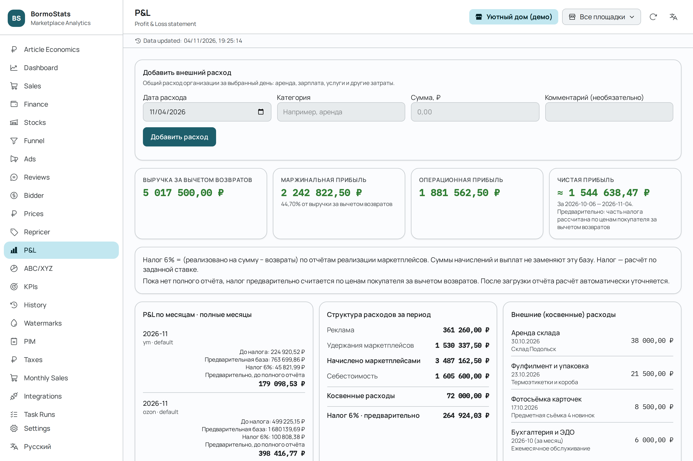<br><sub><b>P&amp;L</b> — gross, operating, and net profit after realization tax with dated and monthly indirect expenses</sub></td>
<td width="50%">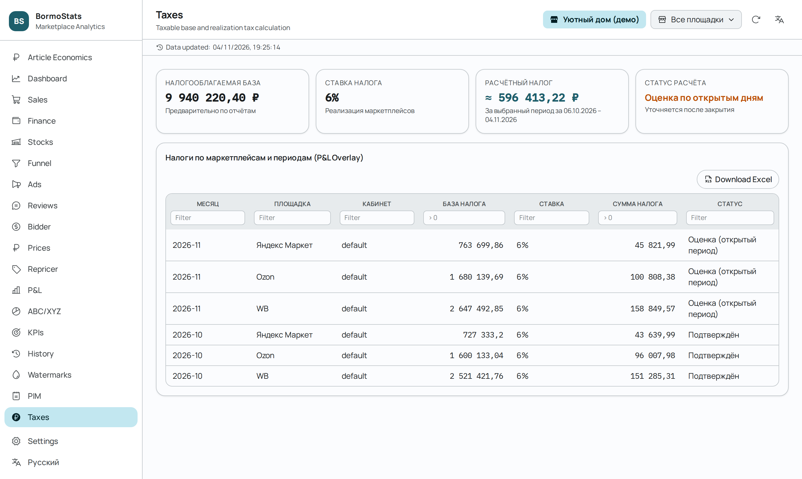<br><sub><b>Taxes</b> — taxable base and realization tax status (confirmed vs. estimated) per marketplace and month</sub></td>
</tr>
<tr>
<td>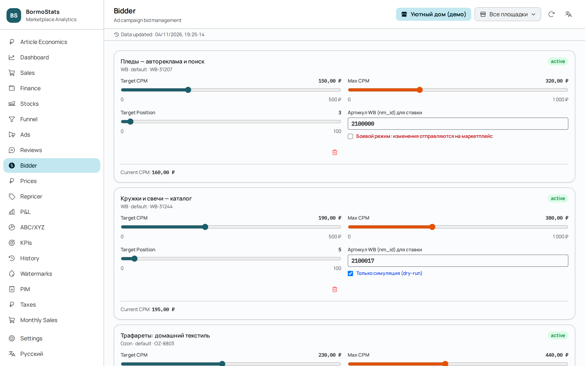<br><sub><b>Bidder</b> — target / max CPM and position rules per campaign, dry-run toggle, and two-phase action log</sub></td>
<td>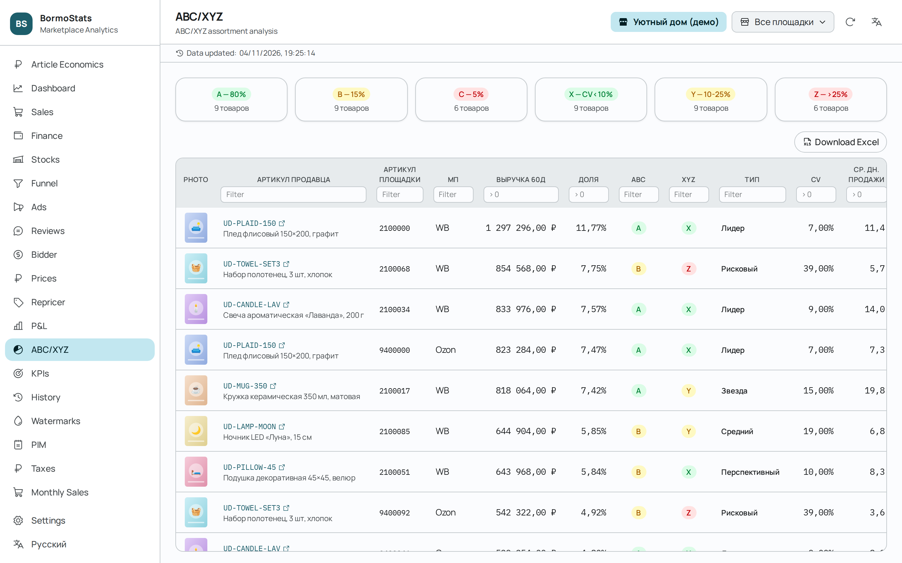<br><sub><b>ABC/XYZ</b> — leaders, stars, and illiquid stock with photos, supplier SKUs, and column filters</sub></td>
</tr>
<tr>
<td>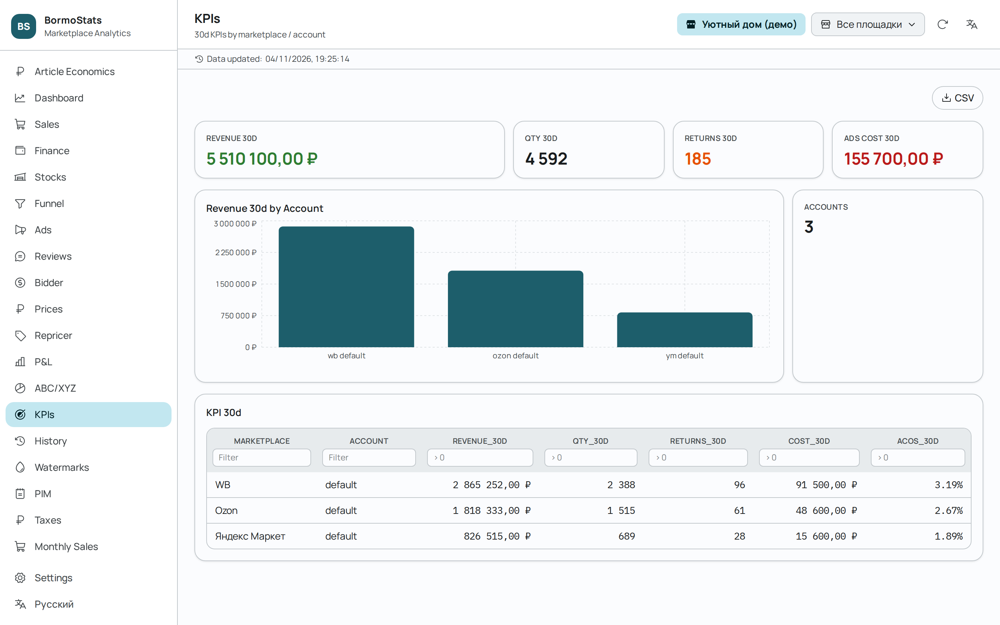<br><sub><b>KPIs</b> — 30-day revenue, units, returns, and ad spend per marketplace account</sub></td>
<td>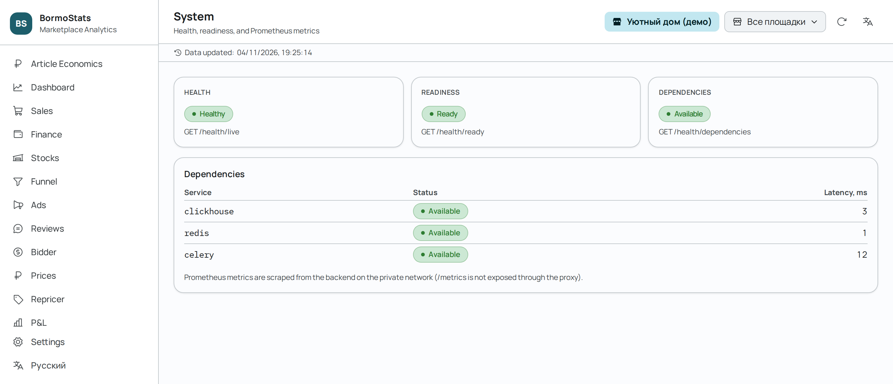<br><sub><b>System</b> — liveness, readiness, dependency latency, and Prometheus metrics sample</sub></td>
</tr>
</table>
</details>

The UI is bilingual (Russian / English) and switches on the fly.

## 🚀 Quick start

**You need:** Docker with Compose v2, `make`, and API tokens of a Wildberries, Ozon, and/or Yandex Market seller account.

```bash
git clone https://github.com/Bormotoon/BormoStats.git
cd BormoStats
make init ENV=dev        # or ENV=stage / ENV=prod
```

`make init` copies `.env.<env>.example` to `.env` and fills every secret (ClickHouse, Redis, admin key,
webhook and metrics tokens) with strong random values. Add your marketplace tokens to `.env`:

| Variable | Where to get it |
|---|---|
| `WB_TOKEN_STATISTICS`, `WB_TOKEN_ANALYTICS` | WB seller portal → Settings → API access (“Statistics”, “Analytics”) |
| `OZON_CLIENT_ID`, `OZON_API_KEY` | Ozon Seller → Settings → API keys |
| `OZON_PERF_CLIENT_ID`, `OZON_PERF_CLIENT_SECRET` | Ozon ad cabinet → Settings → API *(optional, for ads & SKU ad reports)* |
| `YM_API_KEY`, `YM_BUSINESS_ID`, `YM_CAMPAIGN_ID` | Yandex Market Partner portal → Settings → API modules *(optional, for Yandex Market)* |

Then start the stack:

```bash
make up
```

| What | Where |
|---|---|
| 🖥️ Web UI | <https://localhost:18443/ui/> *(self-signed certificate)* |
| ❤️ Health check | `curl -k https://localhost:18443/health/live` |
| 📈 Metabase | <http://localhost:13000> *(loopback only)* |

> [!TIP]
> The first build takes 3–5 minutes; later builds reuse the Docker layer cache. Data starts flowing on the
> next scheduler tick — use **Admin → Backfill** (or `POST /api/v1/admin/backfill`) to load history right away.

<details>
<summary><b>Run without Docker (bare metal)</b></summary>

Requires **Python 3.14+**, **Node.js 22+**, **ClickHouse**, and **Redis** on the host.

```bash
make init ENV=dev
# set the marketplace tokens, point CH_HOST / REDIS_URL at your services
# (clear REDIS_USERNAME if your Redis has no ACL user)
make install   # venv, dependencies, frontend build, migrations
make run       # backend + Celery worker + Celery beat in one terminal
```

For a server, install the bundled systemd units with `sudo make install-systemd`.

</details>

<details>
<summary><b>Useful make targets</b></summary>

| Command | What it does |
|---|---|
| `make up` / `make down` / `make logs` / `make ps` | Manage the Docker stack |
| `make migrate` / `make migrate-status` / `make migrate-verify` | Apply / inspect / verify ClickHouse migrations and rollbacks |
| `make backup` / `make restore-check` | Back up ClickHouse; verify a backup restores cleanly into a scratch DB |
| `make check` | Lint, format check, strict MyPy typing, migration manifest, waiver checks, and pytest |
| `make check-frontend` | `npm ci` + `npm audit` (high/critical) + production build of the web UI |
| `make check-tokens` | Validate marketplace credentials and smoke-check API access |
| `make perf-smoke` | Quick load smoke test of the API |

Run `make help` for the full list.

</details>

## 🧩 Architecture

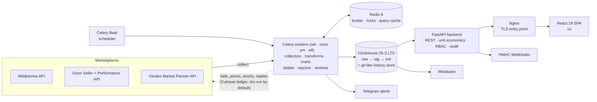

| Component | Technology | Role |
|---|---|---|
| **Backend** | FastAPI 0.135, Uvicorn, Python 3.14 | REST API, $O(N+S)$ SKU unit economics engine, RBAC, audit, health, metrics |
| **Workers** | Celery 5.6 | Collection (`wb`, `ozon`, `ym`), transforms, marts, automation, marketplace actions |
| **Scheduler** | Celery Beat | Periodic ingestion, catalog snapshots, action reconciliation, and maintenance |
| **Warehouse** | ClickHouse 26.3 LTS | OLAP storage (`raw_*` → `stg_*` → `mrt_*`) and append-only history store (`hist_*`) |
| **Broker & Cache** | Redis 8 | Celery broker, distributed locks, and tenant-scoped analytics query cache |
| **Frontend** | React 19, Vite 8, Tailwind CSS 4, Recharts | Single-page web UI served under `/ui` with local fonts and `.xlsx` engine |
| **Proxy** | Nginx 1.31 | The only public entry point, TLS termination, CSP and caching |
| **BI** | Metabase | Ad-hoc SQL and custom dashboards under a read-only ClickHouse user |

**Data flow.** Collectors write raw API responses with normalized keys to `raw_*` tables (idempotent
re-ingestion) and commit versioned snapshots to `hist_*`. Transforms build a unified cross-marketplace model
in `stg_*` and `dim_product`, and marts (`mrt_*`) hold the aggregates that the API and dashboards read.
Watermarks in `sys_watermarks` make collection incremental, `sys_task_runs` audits every run, and
`sys_marketplace_actions` tracks every external write (`pending` → `applied`/`failed` → `confirmed`).
See [docs/architecture.md](docs/architecture.md) and [docs/data_catalog.md](docs/data_catalog.md).

<details>
<summary><b>Repository layout</b></summary>

```text
BormoStats/
├── backend/            FastAPI app: api/v1 routes, services, SQL queries, models, auth & RBAC
├── workers/            Celery app, beat schedule, tasks, SQL transforms and marts
├── collectors/         WB, Ozon, Yandex Market and competitor API clients, parsers, retry/circuit breaker
├── common/             Shared engines: article unit economics, P&L realization tax, finance mapping, XLSX parser
├── warehouse/          ClickHouse migrations (0001–0051 with rollbacks) and reference DDL
├── frontend/           React 19 SPA, Playwright E2E tests, unit tests, README screenshot generator
├── automation/         YAML rules engine and Telegram actions
├── browser_extension/  Competitor & SERP overlay for WB, Ozon, and Yandex Market product pages
├── infra/              Docker Compose, Nginx, ClickHouse, Redis, Prometheus, systemd units
├── dashboards/         Metabase / Grafana dashboards
├── scripts/            Bootstrap, backup, restore-check, backfill, and operator utilities
├── tests/              Unit, worker, and Docker ClickHouse/Redis integration test suites
└── docs/               Operations, security, Yandex Market parity, and design documentation
```

</details>

## 📡 API

Every endpoint lives under `/api/v1` and requires an `X-API-Key` header (or a session token from `POST /api/v1/auth/login`).
The OpenAPI contract is served to authenticated callers at `/api/v1/openapi.json`.

- **User keys** (`bsk_<id>_<secret>`) are shown once and stored as salted `scrypt` hashes. The organization
  and role (`owner`, `admin`, `manager`, `analyst`, `viewer`) come from the key — a request can never pick another tenant.
  Keys expire, rotate, and revoke; password changes immediately revoke active sessions and purge cached credentials.
- **Platform master key** (`ADMIN_API_KEY`) is for operators only: admin operations and cross-tenant work
  via `X-Organization-Id`. Restrict it to your networks with `ADMIN_ALLOWED_NETWORKS`.

```bash
curl -k -H "X-API-Key: $BORMOSTATS_KEY" \
  "https://localhost:18443/api/v1/sales/daily?marketplace=wb&date_from=2026-10-01&date_to=2026-10-31"
```

<details>
<summary><b>Endpoint overview</b></summary>

| Area | Endpoints |
|---|---|
| Unit Economics | `GET /economics` *(66-column per-SKU unit economics across WB, Ozon, YM; requires Manager+)* |
| Analytics | `GET /sales/daily`, `/funnel/daily`, `/ads/daily`, `/stocks/current` *(supports `as_of`)*, `/kpis`, `/abc-xyz`, `/freshness` |
| Cohort Funnel & Import | `GET /funnel/ozon`, `/funnel/ozon/related`, `/funnel/ozon/finance`; `POST /funnel/ozon/import` *(supports `wb`, `ozon`, `ym`)* |
| Finance & P&L | `GET /finance/daily` *(supports `as_of`)*, `/finance/balance`, `/pnl`, `/pnl/daily`, `/pnl/expenses` (`GET`/`POST`/`DELETE`) |
| Prices | `GET /pricing/breakdown`, `/pricing/compare`, `/pricing/status`, `/pricing/wb-documents`; `PUT /pricing/target/{mp}/{offer}`; `POST /pricing/targets/import`, `/pricing/targets/keep`, `/pricing/costs/import` |
| Repricer & Bidder | `/repricer/rules`, `/repricer/breakeven`, `/bidder/campaigns`, `/bidder/rules`, `/{bidder,repricer}/actions` |
| Reviews | `GET /reviews`, `/reviews/summary`; `POST /reviews/{mp}/{id}/draft`, `/reviews/{mp}/{id}/reply`; `/reviews/templates`, `/reviews/settings` |
| History | `GET /history/repos`, `/history/state`, `/history/commits`, `/history/snapshot`, `/history/changes` |
| Insights | `GET /insights/tasks`, `PATCH /insights/tasks/{id}` |
| PIM | `/pim/products`, `PATCH /pim/products/{mp}/{account}/{product}`, `/pim/brands`, `/pim/categories`, `POST /pim/products/generate-description` |
| Integrations | `GET /integrations/stock/config`, `POST /integrations/stock/update`; `/integrations/subscriptions` (CRUD, rotate secret, test); `/integrations/logs` |
| Browser Extension | `POST /extension/competitor-price`, `POST /extension/positions`, `GET /extension/keywords` |
| Exports | `POST /exports`, `GET /exports/{id}`, `/exports/{id}/download` |
| Users & Orgs | `POST /auth/login`, `/auth/logout`, `/auth/password`; `GET /users/me`, `PUT /users/me/organization`; `/users`, `/users/{id}/rotate-key`, `/revoke-key`; `/organizations`, `/accounts` |
| Admin *(master key)* | `GET /admin/watermarks`, `/admin/task-runs`; `POST /admin/backfill`, `/admin/transforms/*`, `/admin/marts/*`, `/admin/maintenance/*` |

Common query parameters: `marketplace` (`wb` / `ozon` / `ym`), `account_id`, `date_from` / `date_to`
(up to 92 days), `as_of`, `limit` / `offset`. Errors follow a uniform envelope:
`{"detail": "...", "error": {"code": "...", "message": "..."}}`.

</details>

> [!IMPORTANT]
> Bidder and repricer rules are created in **dry-run**: changes are simulated and logged only. Going live
> requires both the `execute:marketplace` scope on the rule and `MARKETPLACE_ACTIONS_ENABLED=true` on the
> server. Every live action is tracked through a two-phase commit ledger with read-after-write reconciliation.
> Details in [docs/marketplace_actions.md](docs/marketplace_actions.md).

## 🔧 Configuration

All settings come from `.env`; the annotated templates are [`.env.example`](.env.example) and
`.env.{dev,stage,prod}.example`. `make init` generates every secret for you.

<details>
<summary><b>Marketplace and feature variables</b></summary>

| Variable | Purpose |
|---|---|
| `WB_TOKEN_STATISTICS`, `WB_TOKEN_ANALYTICS` | WB sales, orders, stocks, funnel *(required for WB)* |
| `WB_TOKEN_FINANCE` | WB balance and realization reports (defaults to the statistics token) |
| `WB_TOKEN_MARKETPLACE`, `WB_TOKEN_PRICES`, `WB_TOKEN_PROMOTION` | WB write APIs: stocks, prices, ad bids |
| `WB_TOKEN_CONTENT`, `WB_TOKEN_FEEDBACKS` | Product-card history & safety-document check; reviews and replies |
| `OZON_CLIENT_ID`, `OZON_API_KEY` | Ozon Seller API: postings, stocks, finance, realization, CIS buyouts *(required for Ozon)* |
| `OZON_PERF_CLIENT_ID`, `OZON_PERF_CLIENT_SECRET` | Ozon Performance API: ad campaigns and SKU-attributed ad reports |
| `YM_API_KEY`, `YM_BUSINESS_ID`, `YM_CAMPAIGN_ID` | Yandex Market Partner API: orders, stats, stocks, funnel, boost ads, finance *(required for YM)* |
| `YM_API_KEY_PRICING`, `YM_API_KEY_REVIEWS` | Optional separate write keys for Yandex Market price updates and review replies |
| `YM_STOCK_MODE`, `YM_ACCOUNT_ID` | YM stock mode (`grouped` or `partner` warehouse) and logical account identifier |
| `TG_BOT_TOKEN`, `TG_CHAT_ID` | Telegram alerts and daily digests |
| `AI_API_URL`, `AI_API_KEY`, `AI_MODEL` | Any OpenAI-compatible endpoint for SEO descriptions and review replies |
| `COMPETITOR_TRACKED_NM_IDS`, `COMPETITOR_TRACKED_OZON_IDS`, `COMPETITOR_TRACKED_KEYWORDS` | Optional competitor tracking |
| `MARKETPLACE_ACTIONS_ENABLED` | Global kill switch for live bid / price / review changes (default `false`) |
| `HISTORY_ENABLED` | Archive every product-card change and ingested row in `hist_*` (default `true`) |

</details>

<details>
<summary><b>Security and operations variables</b></summary>

| Variable | Purpose | Default |
|---|---|---|
| `ADMIN_API_KEY` | Platform master key | generated |
| `ADMIN_ALLOWED_NETWORKS` | CIDRs allowed to use the master key | any |
| `CORS_ORIGINS` | Comma-separated allowed CORS origins for `/api/` | empty (same-origin) |
| `WEBHOOK_SECRET_KEY` | Encrypts webhook signing secrets at rest (AES-GCM) | generated |
| `METRICS_BEARER_TOKEN` | Bearer token required on `/metrics` | generated |
| `QUERY_CACHE_TTL_SECONDS` | Redis analytics query cache TTL (`0` disables) | `300` |
| `CH_RO_USER`, `CH_RO_PASSWORD` | Read-only ClickHouse user for Metabase | — |
| `CH_QUERY_TIMEOUT_SECONDS` | Server-side limit for API queries | `30` |
| `WORKER_CONCURRENCY`, `WORKER_QUEUES` | Worker size and consumed queues (`etl,wb,ozon,ym,…`) | `4` / all |
| `BACKUP_DIR`, `BACKUP_RETENTION_DAYS`, `BACKUP_GPG_RECIPIENT` | `make backup` settings | `./backups` / `14` / — |

</details>

<details>
<summary><b>Default ports</b></summary>

| Service | Port | Exposure |
|---|---|---|
| Nginx HTTP → HTTPS redirect | `18080` | public |
| Nginx HTTPS (UI + API) | `18443` | public |
| Metabase | `13000` | loopback |
| ClickHouse HTTP | `18123` | loopback |
| Worker / Beat metrics | `19101` / `19102` | loopback |

Change the mappings in `.env` if they clash with other services.

</details>

## 🛡️ Security

- **Hardened runtime**: containers run as a non-root user with read-only file systems, `no-new-privileges`, and `tmpfs` for `/tmp`.
- **Network isolation**: Nginx is the only public entry point; ClickHouse, Redis, Metabase, and metrics stay on internal Docker networks or host loopback.
- **Least privilege DB access**: the application uses a dedicated ClickHouse user (`analytics_app`), never the bootstrap admin.
- **Defensive HTTP & input sanitization**: strict `Content-Security-Policy`, `HSTS`, `X-Content-Type-Options: nosniff`, `X-Frame-Options: SAMEORIGIN`, `.xlsx` zip-bomb and XML buffer-overflow guards, CSV spreadsheet formula-injection neutralization, SQL loader path-traversal bounds verification, and UI image URL protocol whitelisting.
- **RBAC & session security**: `scrypt`-hashed keys, instant session revocation and auth cache invalidation on credential or membership changes, and strict `ManagerAuth` protection on COGS and financial endpoints.
- **Supply chain**: dependencies are hash-locked (`requirements*.txt`, `package-lock.json`), base images are pinned by SHA-256 digest, and CI runs `pip-audit`, `npm audit`, Grype, and SPDX SBOM generation on every push. See [security_audit_report.md](docs/security_audit_report.md) and [docs/supply_chain_security.md](docs/supply_chain_security.md).

Found a vulnerability? Please **don't** open a public issue — report it privately as described in
[SECURITY.md](SECURITY.md).

## 🧪 Development

```bash
python3 -m venv .venv && ./.venv/bin/pip install -r requirements-dev.txt
make init ENV=dev

make lint            # Ruff check
make format-check    # Ruff format check
make typecheck       # MyPy, strict mode (backend, workers, collectors, automation, warehouse, scripts, common)
make migrate-verify  # Verify ClickHouse migration manifest and rollback scripts (0001–0051)
make test            # pytest: 700+ unit, worker, and ClickHouse/Redis integration tests
make check-frontend  # npm ci + npm audit + production build of the web UI
cd frontend && npm test           # Frontend unit tests (node --test)
cd frontend && npm run test:e2e   # Playwright E2E smoke tests
```

CI runs all of the above plus Docker image builds, Prometheus alert-rule unit tests, browser-extension tests,
migration upgrade/rollback round-trip verification, and a supply-chain gate on every push.

**Regenerating the README screenshots** — no stack or keys needed; the API is mocked and the browser is
blocked from reaching anything but the local preview server:

```bash
cd frontend && npm run build && npm run screenshots   # → docs/screenshots/{en,ru}/*.png
```

## 📖 Documentation

| Topic | Documents |
|---|---|
| Design | [Architecture](docs/architecture.md) · [Data catalog](docs/data_catalog.md) · [History store](docs/history.md) · [Environments](docs/environments.md) |
| Yandex Market | [Integration status](docs/yandex_market_status.md) · [Implementation report](docs/yandex_market_implementation_report.md) · [ID contract](docs/ym_id_contract.md) · [Scenario matrix](docs/ym_scenario_matrix.md) · [Partner API notes](docs/ym_partner_api.md) |
| Security | [Authentication & RBAC](docs/authentication.md) · [Credential rotation](docs/credential_rotation.md) · [Supply chain](docs/supply_chain_security.md) · [Total security audit (2026-11)](docs/security_audit_report.md) · [Audit report (2026-09)](docs/AUDIT_REPORT.md) |
| Features | [Marketplace actions](docs/marketplace_actions.md) · [Pricing plan](docs/pricing_plan.md) · [Webhooks](docs/webhooks.md) · [Metabase](docs/metabase.md) |
| Operations | [Runbooks](docs/runbooks.md) · [Troubleshooting](docs/troubleshooting.md) · [Disaster recovery](docs/disaster_recovery.md) · [Observability](docs/observability.md) · [Prometheus](docs/prometheus.md) · [Performance](docs/performance.md) |
| Releases | [Changelog](CHANGELOG.md) · [Release checklist](docs/release_checklist.md) · [Release management](docs/release_management.md) · [Migration policy](docs/migration_policy.md) |

## 🤝 Contributing

Contributions are welcome! Please read [CONTRIBUTING.md](CONTRIBUTING.md) first and open an issue before
large changes. Bug reports and feature requests go through the
[issue templates](https://github.com/Bormotoon/BormoStats/issues/new/choose). By taking part you agree to
follow the [Code of Conduct](CODE_OF_CONDUCT.md).

## ❤️ Support the project

BormoStats is free, open source, and built in the author's spare time. If it helps your marketplace
business, consider supporting development:

[](https://www.donationalerts.com/r/bormotoon)

A ⭐ on GitHub helps too — it makes the project easier for other sellers to find.

## 📜 License

BormoStats is licensed under the [GNU General Public License v3.0](LICENSE). You may use, study, modify,
and share it; distributed modified versions must be released under the same license.

Wildberries, Ozon, and Yandex Market are trademarks of their respective owners. BormoStats is an independent
project and is not affiliated with or endorsed by any marketplace.

---

<div align="center">

Made with ❤️ for marketplace sellers who want to own their data.

[🌐 Project page](https://xn--80abidn3bem.xn--p1ai/projects/bormostats/) ·
[🐛 Report a bug](https://github.com/Bormotoon/BormoStats/issues/new/choose) ·
[💬 Request a feature](https://github.com/Bormotoon/BormoStats/issues/new/choose) ·
[☕ Donate](https://www.donationalerts.com/r/bormotoon)

</div>
