<div align="center">


# BormoStats

**Self-hosted аналитика, управление ценами и автоматизация для продавцов Wildberries и Ozon.**<br>
Продажи, деньги, остатки, реклама и отзывы в одном месте — на вашем сервере и под вашими ключами.

[](https://github.com/Bormotoon/BormoStats/actions/workflows/ci.yml)
[](https://github.com/Bormotoon/BormoStats/releases/latest)
[](LICENSE)
[](https://github.com/Bormotoon/BormoStats/commits/main)
<br>
[](https://www.python.org/)
[](https://fastapi.tiangolo.com/)
[](https://react.dev/)
[](https://clickhouse.com/)
[](https://docs.celeryq.dev/)
[](https://redis.io/)
[](infra/docker/docker-compose.yml)
<br>
[](https://www.donationalerts.com/r/bormotoon)
[](https://xn--80abidn3bem.xn--p1ai/projects/bormostats/)
[](CONTRIBUTING.md)

[English](README.md) · **Русский**

[Возможности](#-возможности) ·
[Скриншоты](#-скриншоты) ·
[Быстрый старт](#-быстрый-старт) ·
[Архитектура](#-архитектура) ·
[API](#-api) ·
[Настройка](#-настройка) ·
[Документация](#-документация) ·
[Участие](#-участие-в-разработке)

🌐 Страница проекта: **[педобраз.рф/projects/bormostats](https://xn--80abidn3bem.xn--p1ai/projects/bormostats/)**

</div>

<br>

<p align="center">
  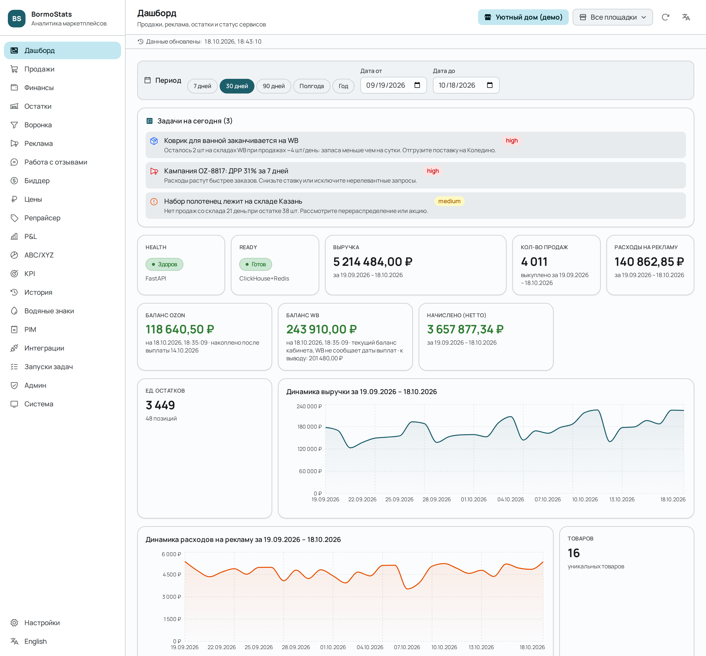
</p>

> [!NOTE]
> На всех скриншотах — **вымышленный демо-магазин**: данные генерирует
> [`frontend/scripts/readme-screenshots.mjs`](frontend/scripts/readme-screenshots.mjs) вместо настоящего API.
> Реальных данных продавцов здесь нет.

---

## 💡 Зачем это нужно

Кабинеты Wildberries и Ozon показывают картину кусками: продажи в одном отчёте, выплаты в другом,
реклама в третьем, и ни один не сводит обе площадки вместе. Сервисы аналитики решают это, но просят
ваши API-ключи и хранят данные у себя.

BormoStats — self-hosted альтернатива. Он забирает всё через **официальные API продавца** ваших
кабинетов в хранилище ClickHouse на вашей машине и даёт поверх него веб-интерфейс, REST API,
BI-дашборды и уведомления в Telegram. А ещё инструменты, которые действуют сами: репрайсер, который
держит цену для покупателя, биддер рекламы и ответы на отзывы с помощью ИИ. Всё, что пишет на
маркетплейс, начинает работу в режиме **симуляции (dry-run)** и включается в боевой режим только
глобальным переключателем.

## ✨ Возможности

<table>
<tr>
<td width="50%" valign="top">

### 📊 Аналитика

- **Продажи, воронка, остатки, реклама** WB и Ozon в единой модели, с фильтром по кабинетам
- **Финансы**: балансы и начисления с разбивкой по комиссии, логистике, хранению, штрафам, выплатам
- **P&L** по месяцам с себестоимостью и косвенными расходами
- **ABC/XYZ**-анализ ассортимента (доля выручки × стабильность спроса)
- **KPI** за 30 дней и операционный **дашборд** с задачами на сегодня
- **Excel везде**: фильтр под каждой колонкой, сортировка и выгрузка любой таблицы в `.xlsx`

</td>
<td width="50%" valign="top">

### 🤖 Автоматизация

- **Цены и репрайсер**: полный разбор цены (скидки, комиссия, логистика, маржа, безубыточность); держит заданную цену *для покупателя*, загрузка целей из Excel
- **Биддер**: правила по CPM и позиции для кампаний WB и Ozon
- **Отзывы**: черновики от ИИ, шаблоны по оценкам, автоответы на отзывы без текста
- **Инсайты**: ежедневный поиск аномалий → список задач и дайджест в Telegram
- **Движок правил на YAML**: высокий ДРР, низкий остаток, нет продаж, залежавшийся товар… (без `eval`)

</td>
</tr>
<tr>
<td valign="top">

### 🗄️ Платформа данных

- **Инкрементальные коллекторы** с водяными знаками, ретраями, circuit breaker и маскированием секретов
- **Трёхслойное хранилище**: `raw_*` → `stg_*` → `mrt_*` в ClickHouse
- **Хранилище истории**: git-подобный архив каждого изменения карточки и каждой загруженной строки — «какая цена была 3 марта?»
- **Metabase** для произвольных SQL-запросов и своих дашбордов
- **PIM**, **вебхуки** с HMAC-подписью и эндпоинт обновления остатков для 1С / МойСклад

</td>
<td valign="top">

### 🛡️ Готов к продакшену

- **Мультиарендность**: организации, роли (`owner` … `viewer`), личные API-ключи, хранящиеся как scrypt-хеши
- **Журнал аудита** всех изменяющих запросов
- **Защищённые контейнеры**: не root, read-only ФС, `no-new-privileges`, единственный вход — через TLS
- **Метрики Prometheus** и правила алертов, структурированные JSON-логи
- **Цепочка поставок**: зависимости с хешами, образы по digest, pip-audit, Grype, SBOM в SPDX

</td>
</tr>
</table>

### Границы проекта

- ✅ Собирает данные **только ваших** кабинетов через официальные API
- ✅ Полностью self-hosted — ничего не уходит третьим лицам (необязательные ИИ-функции обращаются к OpenAI-совместимому API, который *вы* укажете)
- ✅ Необязательное отслеживание конкурентов касается только явно перечисленных вами артикулов и запросов
- ❌ Не парсит каталоги маркетплейсов целиком и не считает доли рынка

## 📸 Скриншоты

<table>
<tr>
<td width="50%">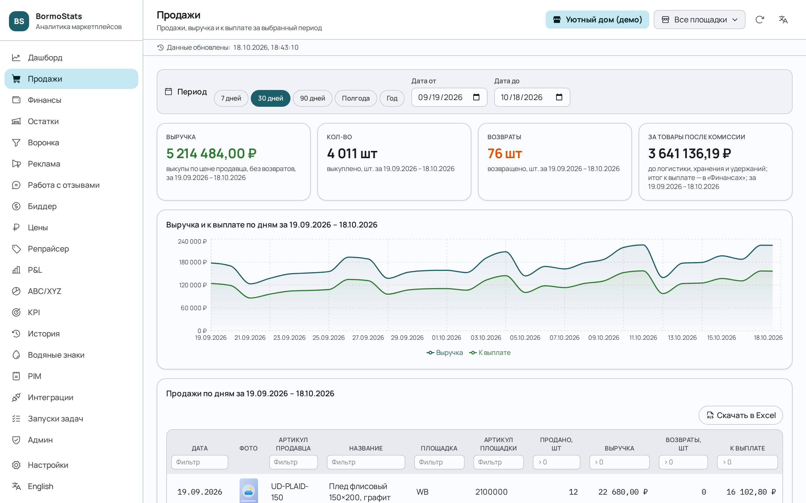<br><sub><b>Продажи</b> — выручка, штуки, возвраты и к выплате по дням, таблица по товарам с выгрузкой в Excel</sub></td>
<td width="50%">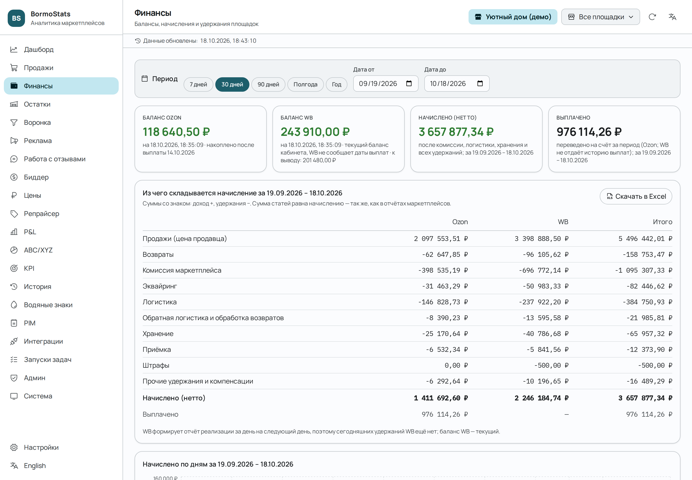<br><sub><b>Финансы</b> — балансы обоих кабинетов и из чего складывается начисление, по статьям</sub></td>
</tr>
<tr>
<td>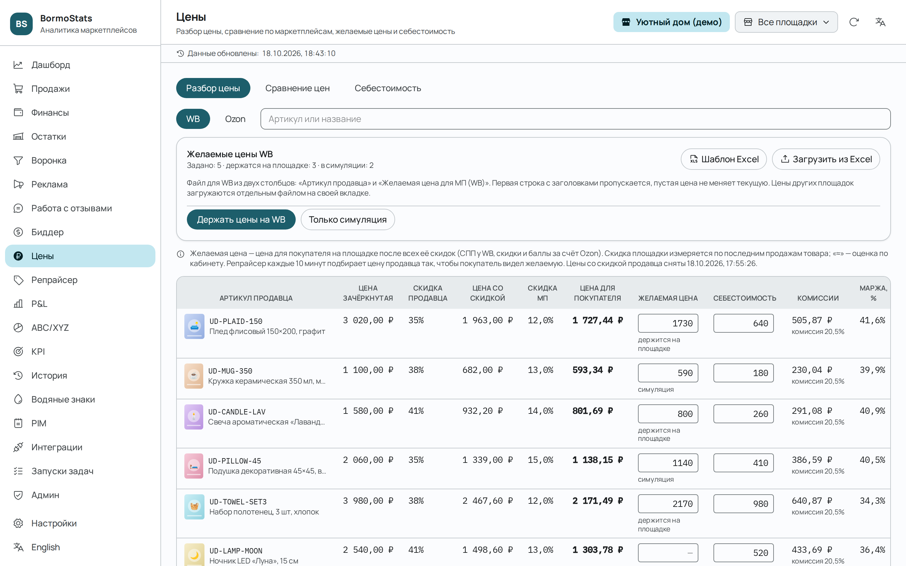<br><sub><b>Цены</b> — от зачёркнутой цены до цены для покупателя, удержания, маржа и безубыточность; желаемые цены держит репрайсер</sub></td>
<td>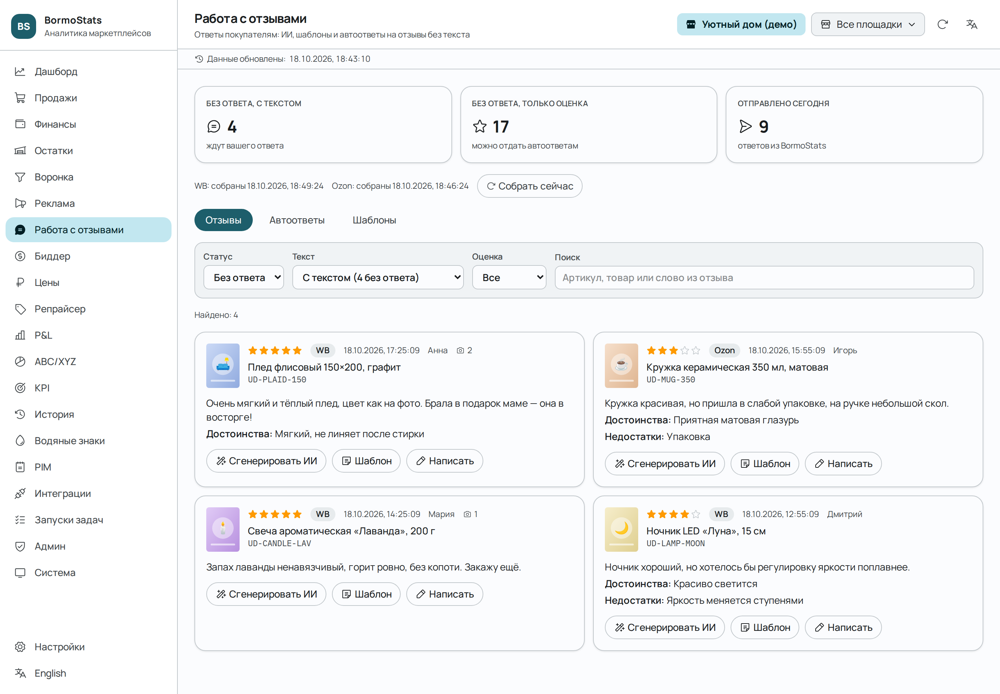<br><sub><b>Отзывы</b> — неотвеченные отзывы обеих площадок, черновики ИИ, шаблоны и автоответы</sub></td>
</tr>
<tr>
<td>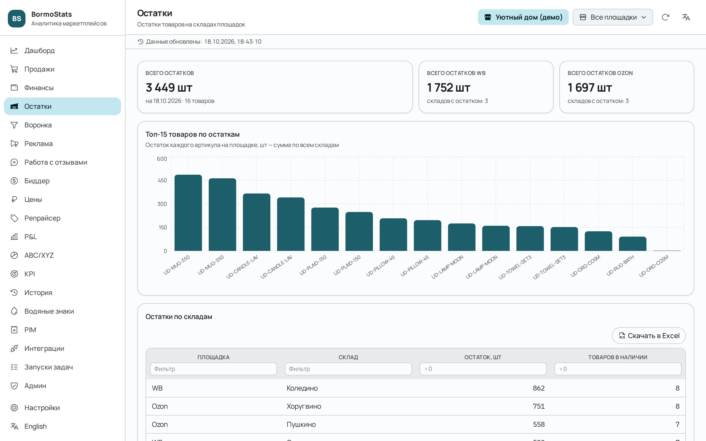<br><sub><b>Остатки</b> — штуки по складам, топ товаров и подсветка заканчивающихся</sub></td>
<td>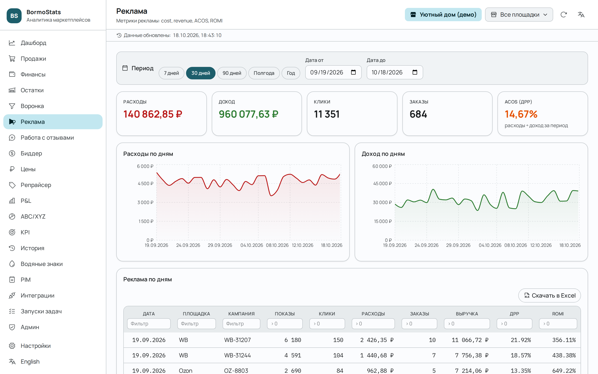<br><sub><b>Реклама</b> — расходы, доход, клики, заказы, ДРР и ROMI по кампаниям и дням</sub></td>
</tr>
</table>

<details>
<summary><b>Ещё скриншоты</b> — воронка, биддер, P&amp;L, ABC/XYZ, KPI, система</summary>
<br>
<table>
<tr>
<td width="50%">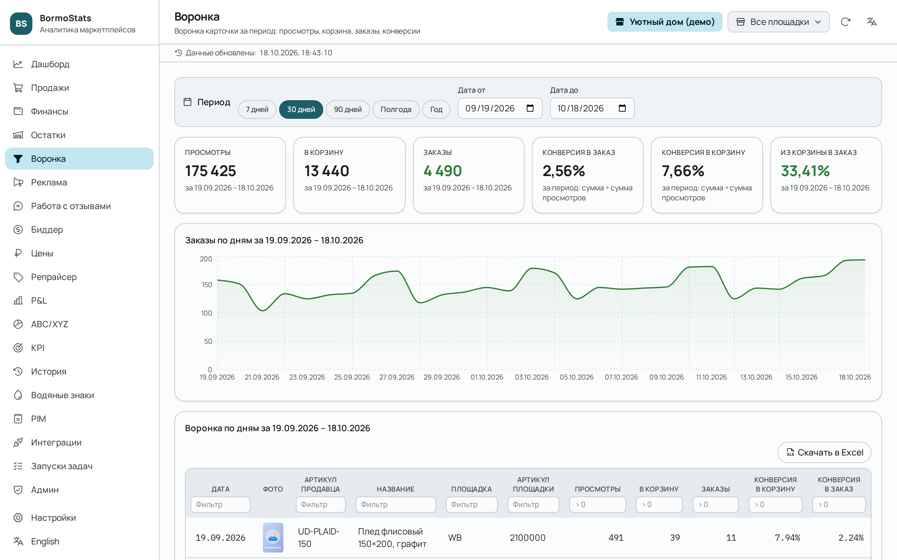<br><sub><b>Воронка</b> — просмотры → корзина → заказы с конверсиями</sub></td>
<td width="50%">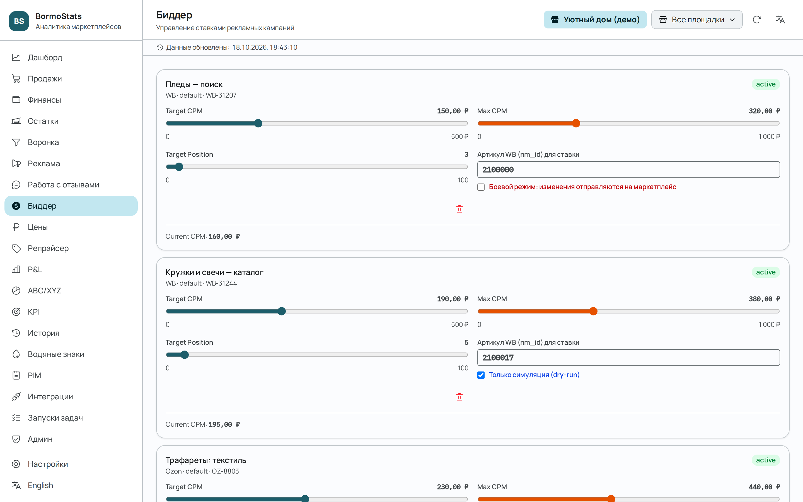<br><sub><b>Биддер</b> — целевой и максимальный CPM, позиция, переключатель симуляции и журнал изменений</sub></td>
</tr>
<tr>
<td>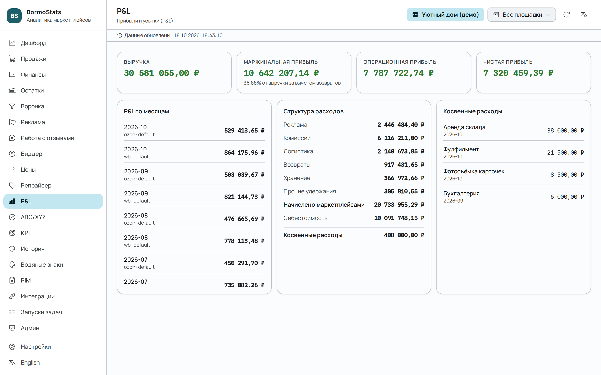<br><sub><b>P&amp;L</b> — маржинальная, операционная и чистая прибыль со структурой расходов</sub></td>
<td>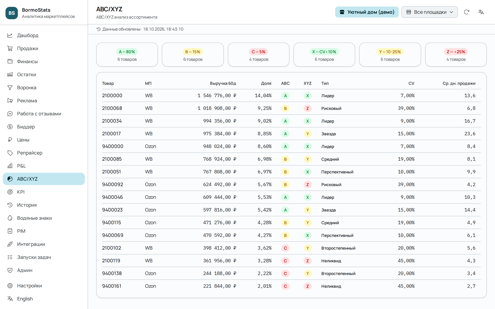<br><sub><b>ABC/XYZ</b> — лидеры, звёзды и неликвид с первого взгляда</sub></td>
</tr>
<tr>
<td>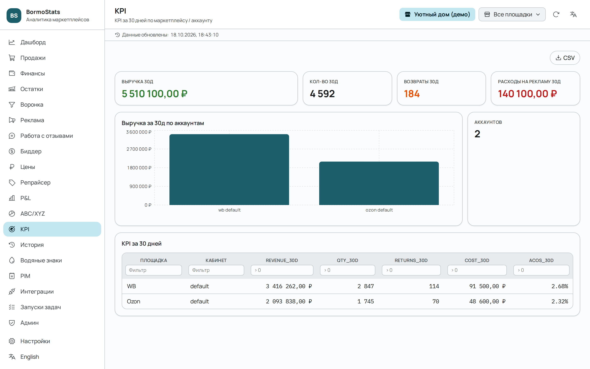<br><sub><b>KPI</b> — выручка, штуки, возвраты и реклама за 30 дней по кабинетам</sub></td>
<td>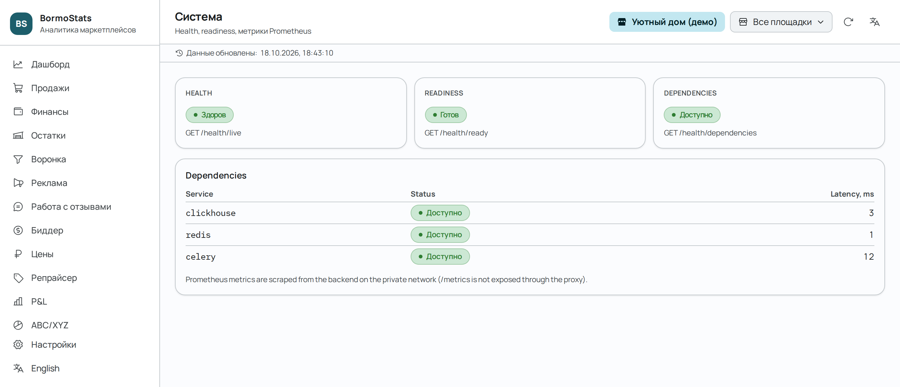<br><sub><b>Система</b> — liveness, readiness и задержки зависимостей</sub></td>
</tr>
</table>
</details>

Интерфейс двуязычный (русский / английский), язык переключается на лету.

## 🚀 Быстрый старт

**Понадобятся:** Docker с Compose v2, `make` и API-токены кабинета продавца Wildberries и/или Ozon.

```bash
git clone https://github.com/Bormotoon/BormoStats.git
cd BormoStats
make init ENV=dev        # или ENV=stage / ENV=prod
```

`make init` копирует `.env.<env>.example` в `.env` и заполняет все секреты (ClickHouse, Redis, ключ
администратора, токены вебхуков и метрик) стойкими случайными значениями. Добавьте в `.env` токены
маркетплейсов:

| Переменная | Где взять |
|---|---|
| `WB_TOKEN_STATISTICS`, `WB_TOKEN_ANALYTICS` | Кабинет WB → Настройки → Доступ к API (категории «Статистика», «Аналитика») |
| `OZON_CLIENT_ID`, `OZON_API_KEY` | Ozon Seller → Настройки → API-ключи |
| `OZON_PERF_CLIENT_ID`, `OZON_PERF_CLIENT_SECRET` | Рекламный кабинет Ozon → Настройки → API *(необязательно, для рекламы)* |

И запустите стек:

```bash
make up
```

| Что | Где |
|---|---|
| 🖥️ Веб-интерфейс | <https://localhost:18443/ui/> *(самоподписанный сертификат)* |
| ❤️ Проверка состояния | `curl -k https://localhost:18443/health/live` |
| 📈 Metabase | <http://localhost:13000> *(только loopback)* |

> [!TIP]
> Первая сборка занимает 3–5 минут, следующие используют кэш слоёв Docker. Данные начнут поступать
> со следующего запуска планировщика; чтобы загрузить историю сразу, используйте **Админ → Backfill**
> (или `POST /api/v1/admin/backfill`).

<details>
<summary><b>Запуск без Docker (на хосте)</b></summary>

Нужны **Python 3.14+**, **Node.js 22+**, **ClickHouse** и **Redis** на хосте.

```bash
make init ENV=dev
# укажите токены маркетплейсов, направьте CH_HOST / REDIS_URL на свои сервисы
# (очистите REDIS_USERNAME, если в вашем Redis нет ACL-пользователя)
make install   # venv, зависимости, сборка фронтенда, миграции
make run       # бэкенд + Celery worker + Celery beat в одном терминале
```

Для сервера установите идущие в комплекте юниты systemd: `sudo make install-systemd`.

</details>

<details>
<summary><b>Полезные команды make</b></summary>

| Команда | Что делает |
|---|---|
| `make up` / `make down` / `make logs` / `make ps` | Управление Docker-стеком |
| `make migrate` / `make migrate-status` | Применить / посмотреть миграции ClickHouse |
| `make backup` / `make restore-check` | Резервная копия ClickHouse; проверка восстановления из неё |
| `make check` | Линтер, проверка форматирования, строгая типизация, манифест миграций и тесты |
| `make check-tokens` | Проверка токенов маркетплейсов и доступа к API |
| `make perf-smoke` | Быстрый нагрузочный smoke-тест API |

Полный список — `make help`.

</details>

## 🧩 Архитектура

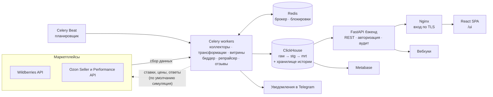

| Компонент | Технологии | Роль |
|---|---|---|
| **Бэкенд** | FastAPI, Uvicorn | REST API, веб-интерфейс, health, метрики |
| **Воркеры** | Celery 5.6 | Сбор, трансформации, витрины, автоматизация, действия на маркетплейсах |
| **Планировщик** | Celery Beat | Периодические задачи |
| **Хранилище** | ClickHouse 26.3 LTS | OLAP-хранилище, витрины и история |
| **Брокер** | Redis 8 | Брокер Celery и распределённые блокировки |
| **Фронтенд** | React 19, Vite, Tailwind CSS 4, Recharts | Одностраничный интерфейс под `/ui` |
| **Прокси** | Nginx | Единственная публичная точка входа, TLS |
| **BI** | Metabase | Произвольный SQL и дашборды под read-only пользователем |

**Поток данных.** Коллекторы пишут сырые ответы API с нормализованными ключами в таблицы `raw_*`
(повторная загрузка идемпотентна), трансформации строят единую модель обеих площадок в `stg_*`,
а витрины `mrt_*` хранят агрегаты, которые читают API и дашборды. Водяные знаки в `sys_watermarks`
делают сбор инкрементальным, а `sys_task_runs` ведёт журнал каждого запуска. Подробнее —
[docs/architecture.md](docs/architecture.md).

<details>
<summary><b>Структура репозитория</b></summary>

```text
BormoStats/
├── backend/            FastAPI: маршруты api/v1, сервисы, SQL-запросы, модели
├── workers/            Celery: расписание, задачи, SQL-трансформации и витрины
├── collectors/         Клиенты API WB, Ozon и конкурентов, парсеры, ретраи и circuit breaker
├── warehouse/          Миграции ClickHouse (с откатами) и эталонный DDL
├── frontend/           React SPA, E2E-тесты Playwright, генератор скриншотов README
├── automation/         Движок правил на YAML и действия в Telegram
├── browser_extension/  Оверлей с аналитикой конкурентов на страницах товаров WB / Ozon
├── infra/              Docker Compose, Nginx, ClickHouse, Redis, конфигурация Prometheus
├── dashboards/         Дашборды Metabase / Grafana
├── scripts/            Бутстрап, бэкапы, бэкфилл и утилиты оператора
├── tests/              Модульные, интеграционные (Docker) тесты и фикстуры
└── docs/               Документация по эксплуатации, безопасности и устройству
```

</details>

## 📡 API

Все эндпоинты находятся под `/api/v1` и требуют заголовок `X-API-Key`. Контракт OpenAPI доступен
авторизованным клиентам по адресу `/api/v1/openapi.json`.

- **Пользовательские ключи** (`bsk_<id>_<secret>`) показываются один раз и хранятся как scrypt-хеш с солью.
  Организация и роль берутся из ключа — запрос не может выбрать чужого арендатора. У ключей есть срок
  действия, ротация и отзыв.
- **Мастер-ключ платформы** (`ADMIN_API_KEY`) — только для операторов: админ-операции и работа с
  любой организацией через `X-Organization-Id`. Ограничьте его своими сетями через `ADMIN_ALLOWED_NETWORKS`.

```bash
curl -k -H "X-API-Key: $BORMOSTATS_KEY" \
  "https://localhost:18443/api/v1/sales/daily?marketplace=wb&date_from=2026-10-01&date_to=2026-10-18"
```

<details>
<summary><b>Обзор эндпоинтов</b></summary>

| Раздел | Эндпоинты |
|---|---|
| Аналитика | `GET /sales/daily`, `/funnel/daily`, `/ads/daily`, `/stocks/current`, `/kpis`, `/abc-xyz`, `/pnl`, `/freshness` |
| Финансы | `GET /finance/daily`, `/finance/balance` |
| Цены | `GET /pricing/breakdown`, `/pricing/compare`; `PUT /pricing/target/{mp}/{offer}`; `POST /pricing/targets/import`, `/pricing/targets/keep`, `/pricing/costs/import` |
| Репрайсер и биддер | `/repricer/rules`, `/repricer/breakeven`, `/bidder/campaigns`, `/bidder/rules`, `/{bidder,repricer}/actions` |
| Отзывы | `GET /reviews`, `/reviews/summary`; `POST /reviews/{mp}/{id}/draft`, `/reviews/{mp}/{id}/reply`; шаблоны и настройки |
| История | `GET /history/repos`, `/history/state`, `/history/commits`, `/history/snapshot`, `/history/changes` |
| Инсайты | `GET /insights/tasks`, `PATCH /insights/tasks/{id}` |
| PIM | `/pim/products`, `/pim/brands`, `/pim/categories`, `POST /pim/products/generate-description` |
| Интеграции | `POST /integrations/stock/update`; `/integrations/subscriptions` (CRUD, ротация секрета, тест); `/integrations/logs` |
| Выгрузки | `POST /exports`, `GET /exports/{id}`, `/exports/{id}/download` |
| Пользователи и организации | `POST /auth/login`, `/auth/logout`; `GET /users/me`; `/users`, `/users/{id}/rotate-key`, `/revoke-key`; `/organizations`, `/accounts` |
| Админ *(мастер-ключ)* | `GET /admin/watermarks`, `/admin/task-runs`; `POST /admin/backfill`, `/admin/transforms/*`, `/admin/marts/*`, `/admin/maintenance/*` |

Общие параметры запроса: `marketplace` (`wb` / `ozon`), `account_id`, `date_from` / `date_to`
(до 92 дней), `limit` / `offset`. Формат ошибки:
`{"detail": "...", "error": {"code": "...", "message": "..."}}`.

</details>

> [!IMPORTANT]
> Правила биддера и репрайсера создаются в режиме **симуляции**: изменения только моделируются и
> записываются в журнал. Для боевого режима нужны и право `execute:marketplace` на правиле, и
> `MARKETPLACE_ACTIONS_ENABLED=true` на сервере. Подробнее — [docs/marketplace_actions.md](docs/marketplace_actions.md).

## 🔧 Настройка

Все настройки берутся из `.env`; шаблоны с комментариями — [`.env.example`](.env.example) и
`.env.{dev,stage,prod}.example`. `make init` сам генерирует все секреты.

<details>
<summary><b>Маркетплейсы и функции</b></summary>

| Переменная | Назначение |
|---|---|
| `WB_TOKEN_STATISTICS`, `WB_TOKEN_ANALYTICS` | Продажи, заказы, остатки, воронка WB *(обязательно для WB)* |
| `WB_TOKEN_FINANCE` | Баланс и отчёты о реализации WB (по умолчанию — токен статистики) |
| `WB_TOKEN_MARKETPLACE`, `WB_TOKEN_PRICES`, `WB_TOKEN_PROMOTION` | API записи WB: остатки, цены, ставки рекламы |
| `WB_TOKEN_CONTENT`, `WB_TOKEN_FEEDBACKS` | История карточек; отзывы и ответы на них |
| `OZON_CLIENT_ID`, `OZON_API_KEY` | Ozon Seller API *(обязательно для Ozon)* |
| `OZON_PERF_CLIENT_ID`, `OZON_PERF_CLIENT_SECRET` | Ozon Performance API (реклама) |
| `TG_BOT_TOKEN`, `TG_CHAT_ID` | Уведомления и дайджесты в Telegram |
| `AI_API_URL`, `AI_API_KEY`, `AI_MODEL` | Любой OpenAI-совместимый API для описаний и ответов на отзывы |
| `COMPETITOR_TRACKED_NM_IDS`, `COMPETITOR_TRACKED_OZON_IDS`, `COMPETITOR_TRACKED_KEYWORDS` | Необязательное отслеживание конкурентов |
| `MARKETPLACE_ACTIONS_ENABLED` | Глобальный выключатель боевых изменений ставок и цен (по умолчанию `false`) |
| `HISTORY_ENABLED` | Архив всех изменений карточек и загруженных строк (по умолчанию `true`) |

</details>

<details>
<summary><b>Безопасность и эксплуатация</b></summary>

| Переменная | Назначение | По умолчанию |
|---|---|---|
| `ADMIN_API_KEY` | Мастер-ключ платформы | генерируется |
| `ADMIN_ALLOWED_NETWORKS` | CIDR, из которых разрешён мастер-ключ | любые |
| `WEBHOOK_SECRET_KEY` | Шифрует секреты подписи вебхуков (AES-GCM) | генерируется |
| `METRICS_BEARER_TOKEN` | Bearer-токен для `/metrics` | генерируется |
| `CH_RO_USER`, `CH_RO_PASSWORD` | Read-only пользователь ClickHouse для Metabase | — |
| `CH_QUERY_TIMEOUT_SECONDS` | Серверный лимит времени запросов API | `30` |
| `WORKER_CONCURRENCY`, `WORKER_QUEUES` | Размер воркера и его очереди | `4` / все |
| `BACKUP_DIR`, `BACKUP_RETENTION_DAYS`, `BACKUP_GPG_RECIPIENT` | Настройки `make backup` | `./backups` / `14` / — |

</details>

<details>
<summary><b>Порты по умолчанию</b></summary>

| Сервис | Порт | Доступ |
|---|---|---|
| Nginx HTTP → редирект на HTTPS | `18080` | публичный |
| Nginx HTTPS (интерфейс + API) | `18443` | публичный |
| Metabase | `13000` | loopback |
| ClickHouse HTTP | `18123` | loopback |
| Метрики worker / beat | `19101` / `19102` | loopback |

Если порты заняты другими сервисами, поменяйте их в `.env`.

</details>

## 🛡️ Безопасность

- Контейнеры работают не от root, с read-only файловой системой, `no-new-privileges` и `tmpfs` для `/tmp`.
- Единственная публичная точка входа — Nginx; ClickHouse, Redis, Metabase и метрики остаются во внутренних сетях или на loopback.
- Приложение ходит в ClickHouse отдельным пользователем, а не бутстрап-администратором.
- Секреты в логах маскируются; для токенов маркетплейсов описана ротация ([docs/credential_rotation.md](docs/credential_rotation.md)).
- Зависимости зафиксированы с хешами, образы — по digest, в CI работают `pip-audit`, `npm audit`, Grype и генерация SBOM.

Нашли уязвимость? Пожалуйста, **не** создавайте публичный issue — сообщите о ней приватно, как описано
в [SECURITY.md](SECURITY.md).

## 🧪 Разработка

```bash
python3 -m venv .venv && ./.venv/bin/pip install -r requirements-dev.txt
make init ENV=dev

make lint            # Ruff
make format-check    # Ruff format
make typecheck       # MyPy, строгий режим
make test            # pytest: модульные + интеграционные с ClickHouse/Redis в Docker
make check-frontend  # npm audit + продакшен-сборка интерфейса
cd frontend && npm run test:e2e   # E2E smoke-тесты Playwright
```

CI на каждый push запускает те же проверки, а также сборку Docker-образов, тесты правил алертов
Prometheus, тесты браузерного расширения и отчёт по цепочке поставок.

**Как пересоздать скриншоты README** — стек и ключи не нужны: API подменяется моками, а браузеру
запрещены любые запросы, кроме локального preview-сервера:

```bash
cd frontend && npm run build && npm run screenshots   # → docs/screenshots/{en,ru}/*.png
```

## 📖 Документация

| Тема | Документы |
|---|---|
| Устройство | [Архитектура](docs/architecture.md) · [Каталог данных](docs/data_catalog.md) · [Хранилище истории](docs/history.md) · [Окружения](docs/environments.md) |
| Безопасность | [Аутентификация](docs/authentication.md) · [Ротация секретов](docs/credential_rotation.md) · [Цепочка поставок](docs/supply_chain_security.md) |
| Функции | [Действия на маркетплейсах](docs/marketplace_actions.md) · [Вебхуки](docs/webhooks.md) · [Metabase](docs/metabase.md) |
| Эксплуатация | [Ранбуки](docs/runbooks.md) · [Диагностика](docs/troubleshooting.md) · [Аварийное восстановление](docs/disaster_recovery.md) · [Наблюдаемость](docs/observability.md) · [Prometheus](docs/prometheus.md) · [Производительность](docs/performance.md) |
| Релизы | [Журнал изменений](CHANGELOG.md) · [Управление релизами](docs/release_management.md) · [Политика миграций](docs/migration_policy.md) |

> Документация в `docs/` написана в основном на английском.

## 🤝 Участие в разработке

Будем рады вашему вкладу! Сначала прочитайте [CONTRIBUTING.md](CONTRIBUTING.md), а перед крупными
изменениями откройте issue. Сообщения об ошибках и предложения принимаются через
[шаблоны issue](https://github.com/Bormotoon/BormoStats/issues/new/choose). Участвуя в проекте, вы
соглашаетесь соблюдать [Кодекс поведения](CODE_OF_CONDUCT.md).

## ❤️ Поддержать проект

BormoStats бесплатный, открытый и развивается в свободное время автора. Если он помогает вашему
бизнесу на маркетплейсах, поддержите разработку:

[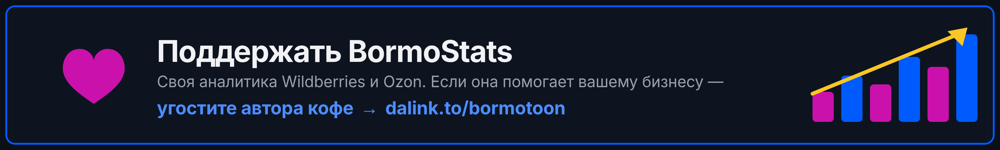](https://www.donationalerts.com/r/bormotoon)

Звезда ⭐ на GitHub тоже помогает — так проект легче найти другим продавцам.

## 📜 Лицензия

BormoStats распространяется по лицензии [GNU General Public License v3.0](LICENSE). Его можно
использовать, изучать, изменять и распространять; изменённые версии при распространении должны
выходить под той же лицензией.

Wildberries и Ozon — товарные знаки их правообладателей. BormoStats — независимый проект, не связанный
с маркетплейсами и не одобренный ими.

---

<div align="center">

Сделано с ❤️ для продавцов, которые хотят владеть своими данными.

[🌐 Страница проекта](https://xn--80abidn3bem.xn--p1ai/projects/bormostats/) ·
[🐛 Сообщить об ошибке](https://github.com/Bormotoon/BormoStats/issues/new/choose) ·
[💬 Предложить идею](https://github.com/Bormotoon/BormoStats/issues/new/choose) ·
[☕ Поддержать](https://www.donationalerts.com/r/bormotoon)

</div>
