<div align="center">


# BormoStats

**Self-hosted аналитика, поартикульная юнит-экономика, управление ценами и автоматизация для продавцов Wildberries, Ozon и Яндекс Маркета.**<br>
Продажи, юнит-экономика, финансы, налоги, остатки, реклама и отзывы в одном месте — на вашем сервере и под вашими ключами.

[](https://github.com/Bormotoon/BormoStats/actions/workflows/ci.yml)
[](https://github.com/Bormotoon/BormoStats/releases/latest)
[](LICENSE)
[](https://github.com/Bormotoon/BormoStats/commits/main)
<br>
[](https://www.python.org/)
[](https://fastapi.tiangolo.com/)
[](https://react.dev/)
[](https://clickhouse.com/)
[](https://docs.celeryq.dev/)
[](https://redis.io/)
[](infra/docker/docker-compose.yml)
<br>
[](https://www.donationalerts.com/r/bormotoon)
[](https://xn--80abidn3bem.xn--p1ai/projects/bormostats/)
[](CONTRIBUTING.md)

[English](README.md) · **Русский**

[Возможности](#-возможности) ·
[Скриншоты](#-скриншоты) ·
[Быстрый старт](#-быстрый-старт) ·
[Архитектура](#-архитектура) ·
[API](#-api) ·
[Настройка](#-настройка) ·
[Безопасность](#-безопасность) ·
[Документация](#-документация) ·
[Участие](#-участие-в-разработке)

🌐 Страница проекта: **[педобраз.рф/projects/bormostats](https://xn--80abidn3bem.xn--p1ai/projects/bormostats/)**

</div>

<br>

<p align="center">
  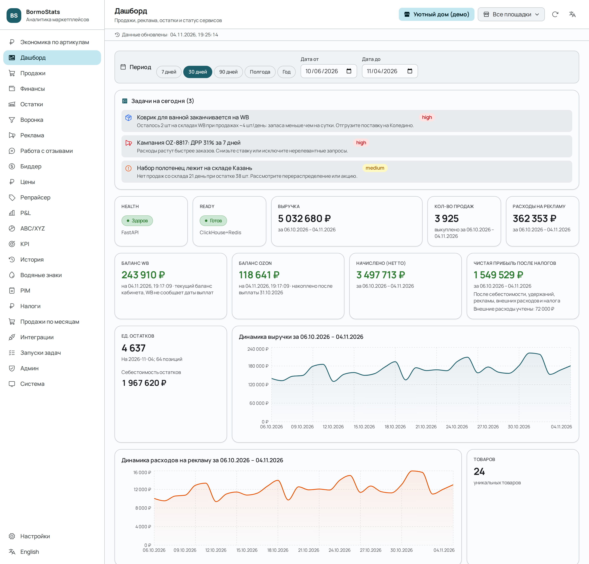
</p>

> [!NOTE]
> На всех скриншотах — **вымышленный демо-магазин** на Wildberries, Ozon и Яндекс Маркете: данные генерирует
> [`frontend/scripts/readme-screenshots.mjs`](frontend/scripts/readme-screenshots.mjs) вместо настоящего API.
> Реальных данных продавцов здесь нет.

---

## 💡 Зачем это нужно

Личные кабинеты Wildberries, Ozon и Яндекс Маркета показывают картину кусками: продажи в одном отчёте,
реализация и выплаты в другом, реклама в третьем — и ни один не сводит юнит-экономику всех трёх площадок и нескольких
юрлиц вместе. Облачные SaaS-сервисы аналитики решают это, но просят ваши API-ключи и хранят всю коммерческую тайну на своих серверах.

BormoStats — **единственная на рынке полнофункциональная self-hosted альтернатива**. Он забирает данные через **официальные API продавца**
ваших кабинетов в колоночное хранилище ClickHouse на вашем сервере и даёт поверх него быстрый веб-интерфейс на React 19,
REST API, BI-дашборды и уведомления в Telegram. А ещё инструменты, которые действуют сами: умный репрайсер, удерживающий
цену для покупателя (с учётом индекса цен и предельной цены акций Ozon), биддер рекламы и ответы на отзывы с помощью ИИ.
Любая запись на маркетплейс проходит через **двухфазный журнал подтверждения** (`pending` → `applied` → `confirmed` со сверкой чтением после записи),
по умолчанию работает в режиме **симуляции (dry-run)** и включается в боевой режим только глобальным рубильником (`MARKETPLACE_ACTIONS_ENABLED=true`).

## ✨ Возможности

<table>
<tr>
<td width="50%" valign="top">

### 📊 Мультимаркетплейс-аналитика и финансы

- **Три площадки в единой модели**: **Wildberries**, **Ozon** и **Яндекс Маркет** с фильтрацией по каждой площадке, кабинету (юрлицу) или сводно по всем сразу
- **Экономика по артикулам (`/#/economics`)**: потоковый $O(N + S)$ движок и таблица в стиле Excel на **66 раскрывающихся столбцов** (краткий вид на 16 столбцов и полный на 66, выбор колонок, продажи РФ и выкупы ЕАЭС/СНГ, привязанная к SKU реклама, строка «Расходы без привязки», налог по реализации, операционная и чистая прибыль, рентабельность, ROI и класс ABC)
- **Универсальная воронка и когорты SKU (`/#/funnel`)**: 50+ метрик трафика, авто/CPC рекламы, оборачиваемости, 90-дневной выкупаемости и прогноза юнит-экономики когорты заказа + ручной дозагруз отчётов воронки из `.xlsx`/`.csv`
- **Финансы и историческая оценка остатков (`as_of`)**: балансы кабинетов и ежедневные начисления с точной разбивкой (комиссия, эквайринг, логистика, обратная логистика, хранение, приёмка, штрафы, выплаты); оценка себестоимости складских остатков на любую дату (`as_of`)
- **Дневной и месячный P&L + Налоги (`/#/pnl`, `/#/taxes`)**: календарное распределение датированных и месячных косвенных расходов, учёт факторинга Ozon, расчёт налога по отчётам реализации (`Подтверждён` по закрытым актам / `Оценка` по открытым дням), калькулятор УСН 6% + 1% свыше 300 тыс. ₽ и сводка продаж по месяцам
- **ABC/XYZ-анализ** ассортимента (доля выручки × стабильность недельного спроса) и **KPI за 30 дней**
- **Excel везде**: фильтрация под каждым столбцом (`> 100`, `10-20`), сортировка и мгновенная выгрузка любой таблицы в `.xlsx`

</td>
<td width="50%" valign="top">

### 🤖 Умная автоматизация и операционка

- **Цены и умный репрайсер (`/#/pricing`, `/#/repricer`)**:
  - Полный разбор цены: зачёркнутая цена, скидка продавца, скидка площадки (СПП WB, баллы за скидки Ozon, софинансирование Я.Маркета), цена для покупателя, удержания, себестоимость, маржа и точка безубыточности
  - Держит заданную цену **для покупателя**; лаконичный шаблон Excel из 2 колонок и массовая загрузка с пометкой «загружено из файла»
  - **Индекс цен и предельная цена Ozon**: плавно снижает цену на шаг `max_step_pct` при `КРАСНОМ` индексе цен (не ниже желаемой), не повышает при `ЖЁЛТОМ` и синхронизирует `min_price` (предельную цену), чтобы автоакции Ozon не продавали товар за полцены
  - **Поведение без продаж**: удержание желаемой цены как цены продавца (`seller_price`) или по медиане кабинета (`account_median`) до первой продажи
  - **Проверка документов WB**: предупреждает о карточках WB без галочки «Документы, подтверждающие безопасность, не требуются»
- **Биддер рекламы (`/#/bidder`)**: управление CPM / ставками и позициями для кампаний WB, Ozon и Яндекс Маркета с двухфазной сверкой
- **Работа с отзывами (`/#/reviews`)**: неотвеченные отзывы с WB, Ozon и Я.Маркета, черновики ответов от ИИ, шаблоны по оценкам (`{имя}`, `{товар}`) и автоответы на отзывы без текста
- **Задачи дня и YAML-правила**: ежедневный поиск аномалий (низкая оборачиваемость, высокий ДРР, залежавшийся товар) → список задач на дашборде и утренний дайджест в Telegram (без `eval`)

</td>
</tr>
<tr>
<td valign="top">

### 🗄️ Платформа данных и интеграции

- **Инкрементальные коллекторы** с водяными знаками (`sys_watermarks`), экспоненциальными ретраями, circuit breaker и маскированием секретов в выделенных очередях Celery (`wb`, `ozon`, `ym`)
- **Трёхслойное хранилище ClickHouse**: `raw_*` → `stg_*` → `mrt_*` (51 версионированная миграция с проверенными rollback-скриптами)
- **Git-подобное хранилище истории (`/#/history`)**: неизменяемый архив (`hist_objects`, `hist_commits`, `hist_refs`, `hist_changes`) каждого снимка карточки и каждой загруженной строки отчёта — можно посмотреть состояние любой карточки или таблицы на любую минуту по Москве
- **PIM (`/#/pim`)**: единый каталог товаров, бренды, категории, inline-редактирование и ИИ-генератор SEO-описаний для WB, Ozon и Я.Маркета
- **Интеграции (`/#/integrations`)**: единый эндпоинт выгрузки остатков (`POST /api/v1/integrations/stock/update`) для 1С / МойСклад (с поддержкой режимов `grouped` и `partner` складов Я.Маркета) и вебхуки с HMAC-подписью
- **Браузерное расширение**: клиентский оверлей цен конкурентов и позиций в поисковой выдаче прямо на страницах карточек WB, Ozon и Яндекс Маркета
- **Metabase**: произвольные SQL-запросы и собственные дашборды под read-only пользователем

</td>
<td valign="top">

### 🛡️ Защита и готовность к продакшену

- **Мультиарендность и RBAC**: организации, роли (`owner`, `admin`, `manager`, `analyst`, `viewer`), личные API-ключи (`bsk_…`), хранящиеся в виде солёных `scrypt`-хешей
- **Защита себестоимости и финансов**: строгое маскирование закупочных цен (`cost_price_rub`), юнит-экономики и финансовых сводок (`ManagerAuth`) для ролей `viewer`/`analyst` в API, CSV-выгрузках и ключах кэша Redis
- **Мгновенный отзыв сессий**: смена пароля, сброс администратором или изменение прав участника организации немедленно отзывают активные сессии и сбрасывают in-memory кэш авторизации
- **Эшелонированная безопасность**: защитные HTTP-заголовки (`CSP`, `HSTS`, `X-Frame-Options`, `nosniff`), защита парсера `.xlsx` от zip-бомб и переполнения буфера, экранирование формул (CSV injection) в выгрузках, защита от path traversal и валидация схем URL картинок в UI
- **Изолированные контейнеры и локальные шрифты**: запуск не от `root`, read-only корневая ФС, `no-new-privileges`, вход только через TLS в Nginx, локальная раздача шрифтов (`Manrope`, `IBM Plex Mono`) без обращений к внешним CDN
- **Цепочка поставок**: зависимости с зафиксированными хешами, Docker-образы по SHA-256 digest, `pip-audit`, `npm audit`, Grype и генерация SPDX SBOM в CI

</td>
</tr>
</table>

### Границы проекта

- ✅ Собирает данные **только ваших** кабинетов через официальные API Wildberries, Ozon и Яндекс Маркета
- ✅ Полностью self-hosted — ничего не уходит третьим лицам (необязательные ИИ-функции обращаются к OpenAI-совместимому API, который *вы* укажете; шрифты и статика раздаются локально)
- ✅ Необязательное отслеживание конкурентов касается только явно перечисленных вами артикулов и поисковых запросов
- ❌ Не парсит каталоги маркетплейсов целиком, не использует прокси-фермы и не собирает чужие доли рынка

## 📸 Скриншоты

<table>
<tr>
<td width="50%">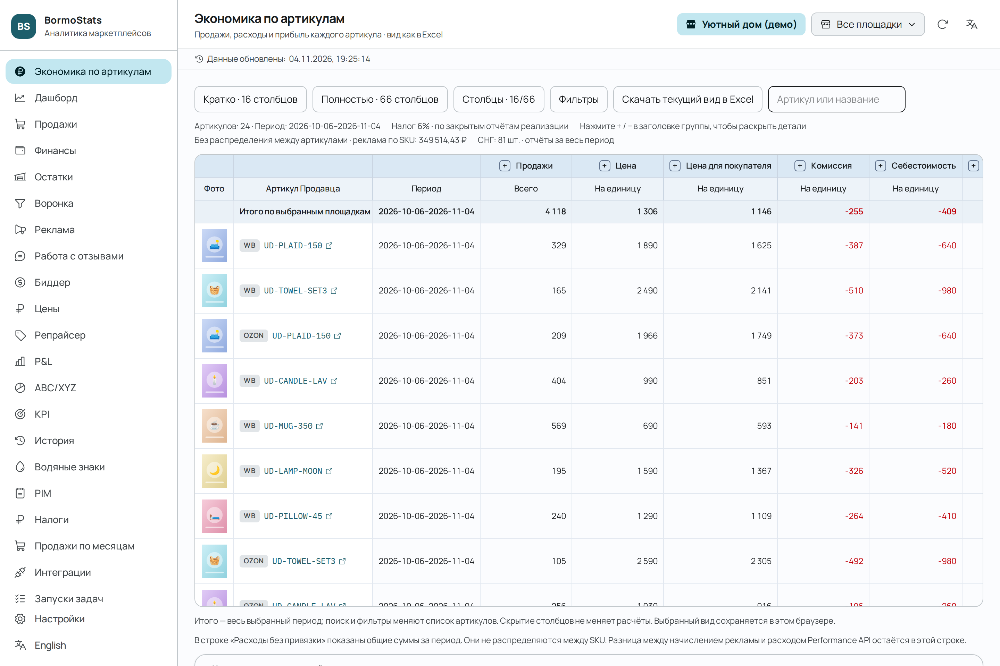<br><sub><b>Экономика по артикулам</b> — 66 раскрывающихся колонок по каждому SKU на WB, Ozon и Я.Маркете: выручка, выкупы РФ и СНГ, комиссии, логистика, реклама по SKU, себестоимость, налог, чистая прибыль и ROI</sub></td>
<td width="50%">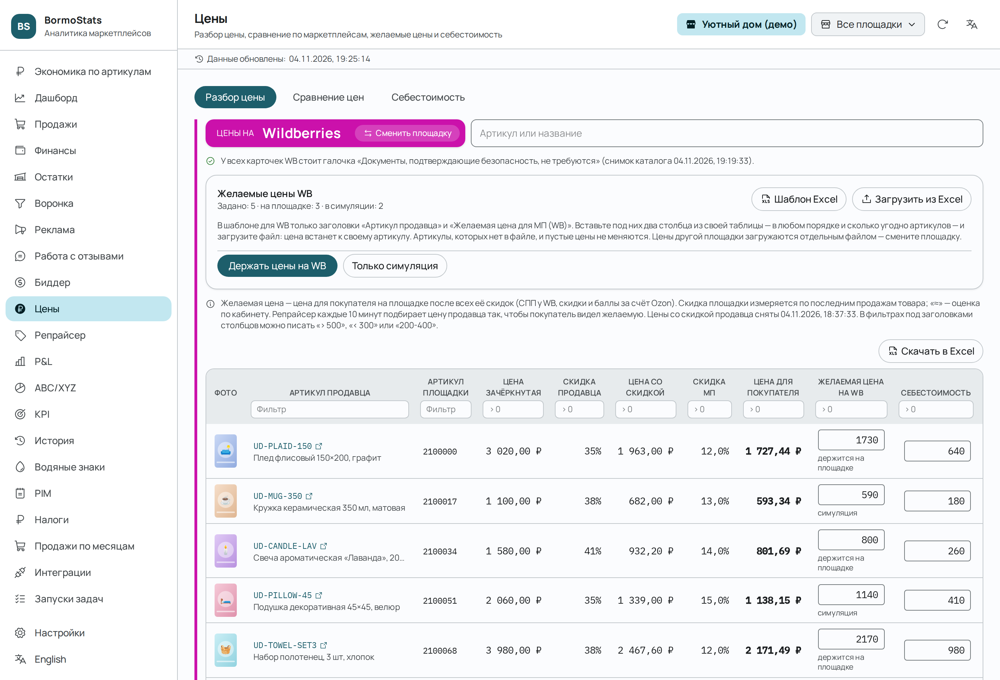<br><sub><b>Цены и репрайсер</b> — от зачёркнутой цены до цены покупателя, проверка галочки документов WB, шаблон и импорт Excel, удержание желаемых цен</sub></td>
</tr>
<tr>
<td>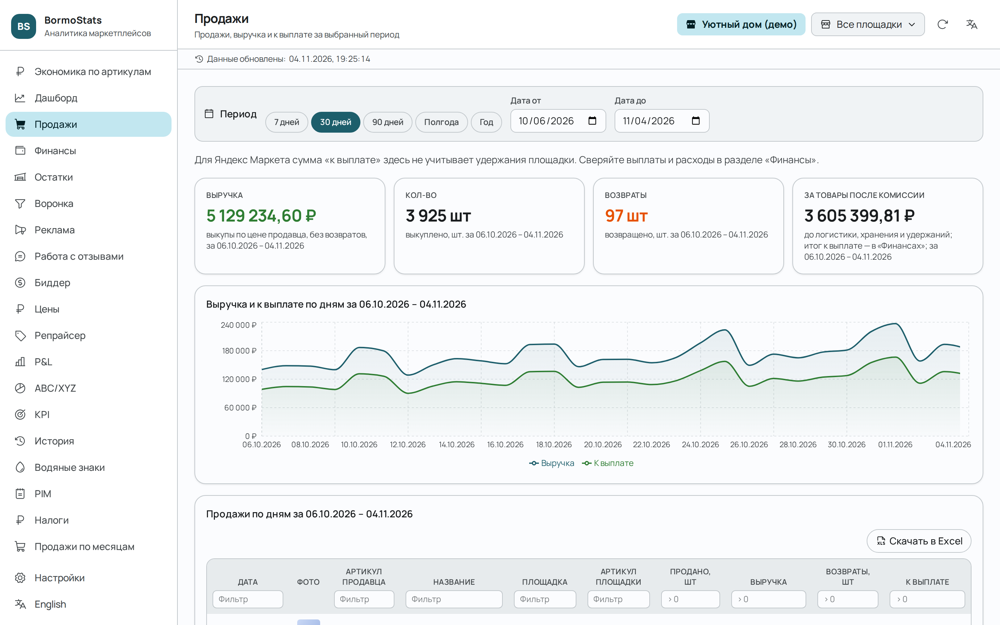<br><sub><b>Продажи</b> — выручка, штуки, возвраты и сумма за товары после комиссии по дням и площадкам с выгрузкой в Excel</sub></td>
<td>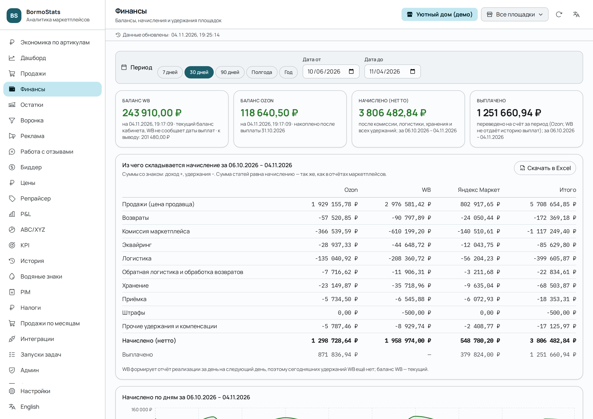<br><sub><b>Финансы</b> — балансы кабинетов и постатейная структура начислений и удержаний по всем площадкам</sub></td>
</tr>
<tr>
<td>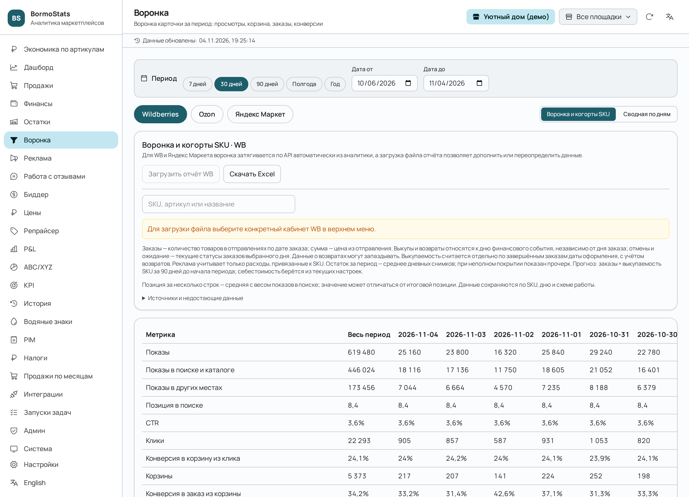<br><sub><b>Воронка и когорты SKU</b> — 50+ метрик воронки, выкупаемости за 90 дней, прогноза прибыли когорты и импорт Excel-отчётов для WB, Ozon и Я.Маркета</sub></td>
<td>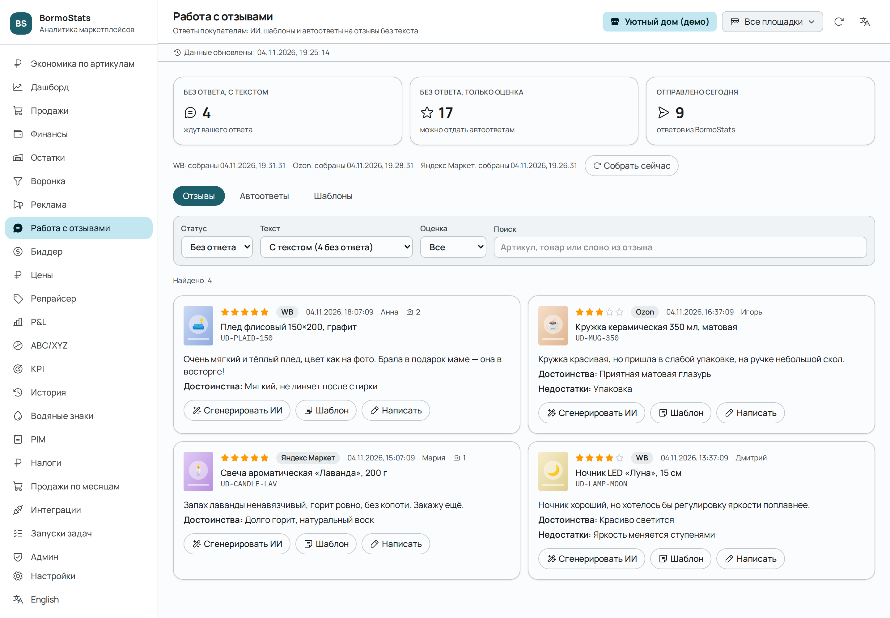<br><sub><b>Отзывы</b> — неотвеченные отзывы со всех трёх площадок, черновики ИИ, шаблоны и автоответы</sub></td>
</tr>
<tr>
<td>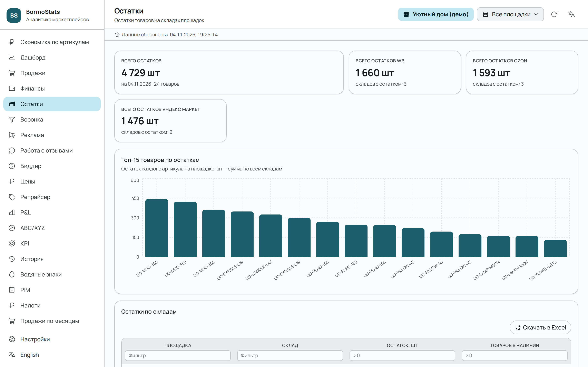<br><sub><b>Остатки</b> — наличие по площадкам и складам, топ товаров и подсветка заканчивающихся позиций</sub></td>
<td>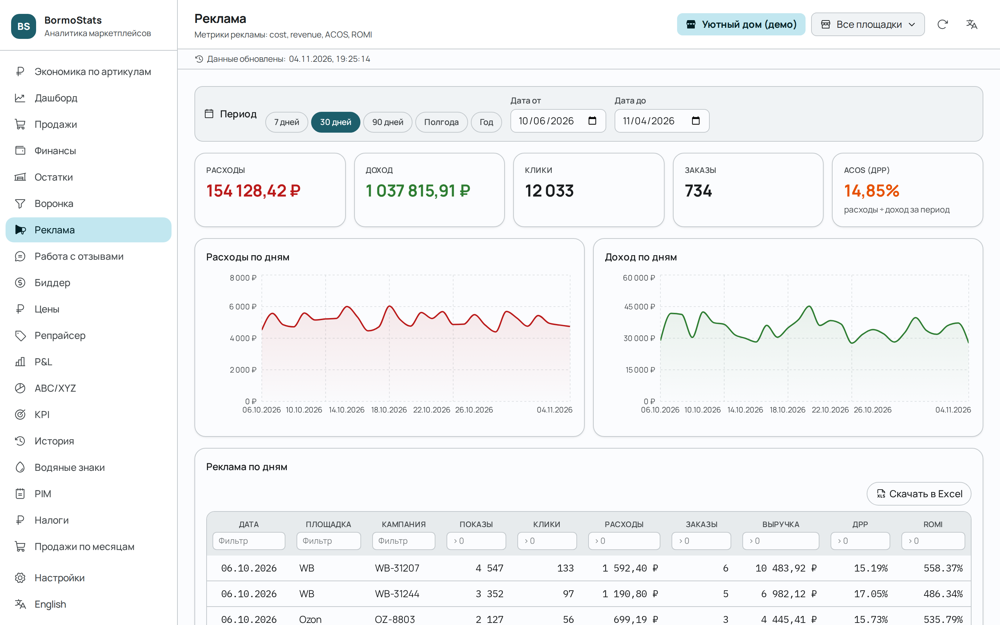<br><sub><b>Реклама</b> — расходы, доход, клики, заказы, ДРР и ROMI по кампаниям и дням</sub></td>
</tr>
</table>

<details>
<summary><b>Ещё скриншоты</b> — P&amp;L, Налоги, Биддер, ABC/XYZ, KPI, Система</summary>
<br>
<table>
<tr>
<td width="50%">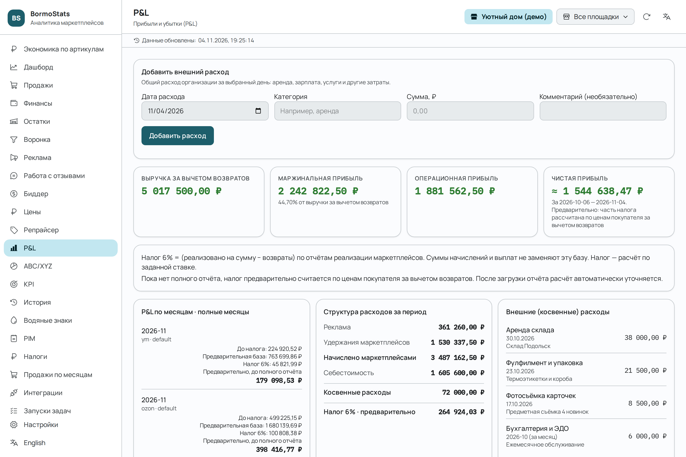<br><sub><b>P&amp;L</b> — маржинальная, операционная и чистая прибыль после налога по отчётам реализации, датированные и месячные косвенные расходы</sub></td>
<td width="50%">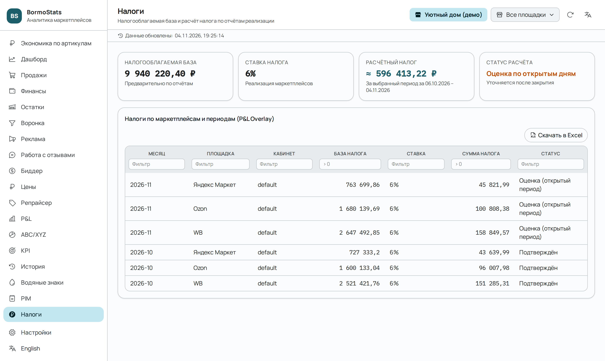<br><sub><b>Налоги</b> — налогооблагаемая база и статус расчёта налога (подтверждён по закрытым актам / оценка по открытым дням) в разрезе площадок</sub></td>
</tr>
<tr>
<td>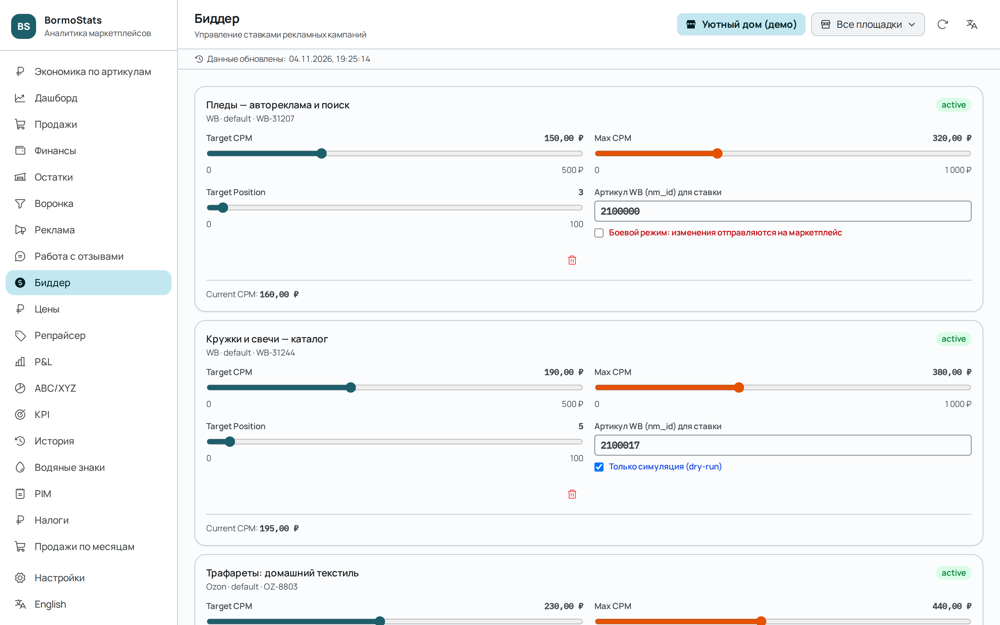<br><sub><b>Биддер</b> — целевой и максимальный CPM, позиция, переключатель симуляции и двухфазный журнал изменений</sub></td>
<td>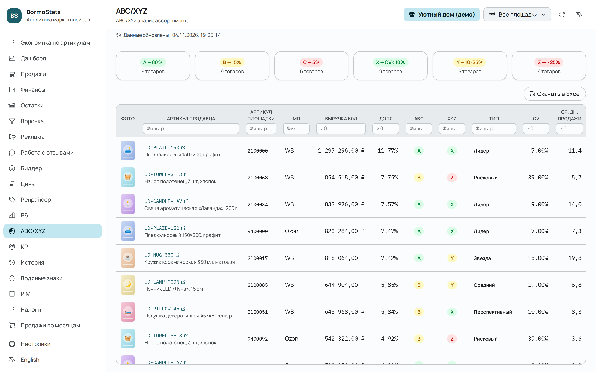<br><sub><b>ABC/XYZ</b> — лидеры, звёзды и неликвид с фотографиями, артикулами продавца и фильтрами по столбцам</sub></td>
</tr>
<tr>
<td>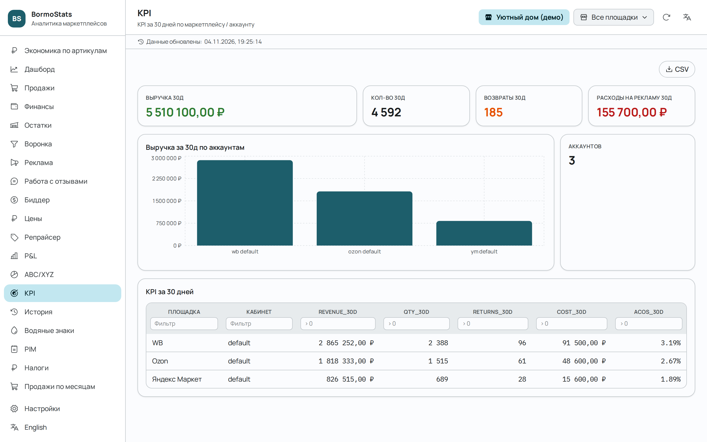<br><sub><b>KPI</b> — выручка, штуки, возвраты и расходы на рекламу за 30 дней по кабинетам WB, Ozon и Я.Маркета</sub></td>
<td>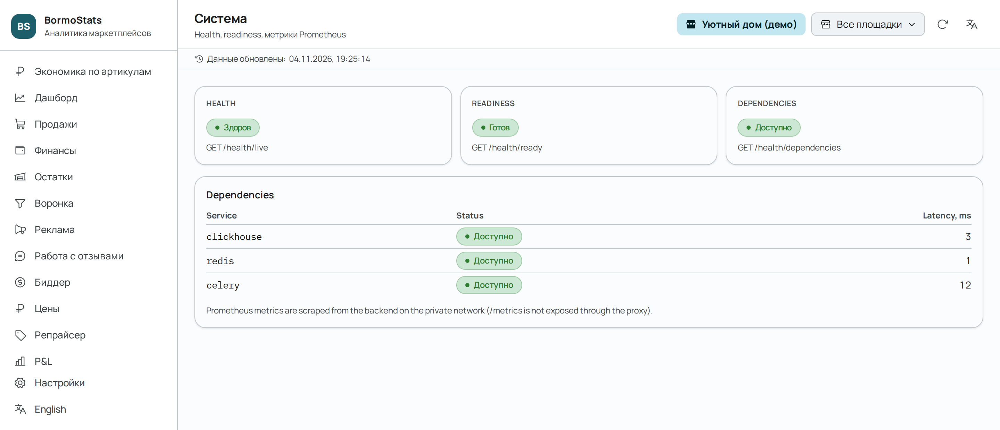<br><sub><b>Система</b> — liveness, readiness, задержки зависимостей и срез метрик Prometheus</sub></td>
</tr>
</table>
</details>

Интерфейс двуязычный (русский / английский), язык переключается на лету.

## 🚀 Быстрый старт

**Понадобятся:** Docker с Compose v2, `make` и API-токены кабинета продавца Wildberries, Ozon и/или Яндекс Маркета.

```bash
git clone https://github.com/Bormotoon/BormoStats.git
cd BormoStats
make init ENV=dev        # или ENV=stage / ENV=prod
```

`make init` копирует `.env.<env>.example` в `.env` и заполняет все секреты (ClickHouse, Redis, ключ
администратора, токены вебхуков и метрик) стойкими случайными значениями. Добавьте в `.env` токены
маркетплейсов:

| Переменная | Где взять |
|---|---|
| `WB_TOKEN_STATISTICS`, `WB_TOKEN_ANALYTICS` | Кабинет WB → Настройки → Доступ к API (категории «Статистика», «Аналитика») |
| `OZON_CLIENT_ID`, `OZON_API_KEY` | Ozon Seller → Настройки → API-ключи |
| `OZON_PERF_CLIENT_ID`, `OZON_PERF_CLIENT_SECRET` | Рекламный кабинет Ozon → Настройки → API *(необязательно, для рекламы и поартикульных отчётов)* |
| `YM_API_KEY`, `YM_BUSINESS_ID`, `YM_CAMPAIGN_ID` | Кабинет продавца Яндекс Маркета → Настройки → Модули и API *(необязательно, для Я.Маркета)* |

И запустите стек:

```bash
make up
```

| Что | Где |
|---|---|
| 🖥️ Веб-интерфейс | <https://localhost:18443/ui/> *(самоподписанный сертификат)* |
| ❤️ Проверка состояния | `curl -k https://localhost:18443/health/live` |
| 📈 Metabase | <http://localhost:13000> *(только loopback)* |

> [!TIP]
> Первая сборка занимает 3–5 минут, следующие используют кэш слоёв Docker. Данные начнут поступать
> со следующего запуска планировщика; чтобы загрузить историю сразу, используйте **Админ → Backfill**
> (или `POST /api/v1/admin/backfill`).

<details>
<summary><b>Запуск без Docker (на хосте)</b></summary>

Нужны **Python 3.14+**, **Node.js 22+**, **ClickHouse** и **Redis** на хосте.

```bash
make init ENV=dev
# укажите токены маркетплейсов, направьте CH_HOST / REDIS_URL на свои сервисы
# (очистите REDIS_USERNAME, если в вашем Redis нет ACL-пользователя)
make install   # venv, зависимости, сборка фронтенда, миграции
make run       # бэкенд + Celery worker + Celery beat в одном терминале
```

Для сервера установите идущие в комплекте юниты systemd: `sudo make install-systemd`.

</details>

<details>
<summary><b>Полезные команды make</b></summary>

| Команда | Что делает |
|---|---|
| `make up` / `make down` / `make logs` / `make ps` | Управление Docker-стеком |
| `make migrate` / `make migrate-status` / `make migrate-verify` | Применить / посмотреть / проверить манифест и откаты миграций ClickHouse |
| `make backup` / `make restore-check` | Резервная копия ClickHouse; проверка чистого восстановления в тестовую БД |
| `make check` | Линтер, проверка форматирования, строгая типизация MyPy, манифест миграций и все тесты |
| `make check-frontend` | `npm ci` + `npm audit` (high/critical) + продакшен-сборка интерфейса |
| `make check-tokens` | Проверка токенов маркетплейсов и доступа к API |
| `make perf-smoke` | Быстрый нагрузочный smoke-тест API |

Полный список — `make help`.

</details>

## 🧩 Архитектура

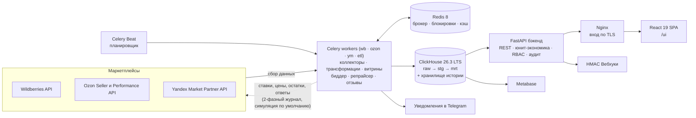

| Компонент | Технологии | Роль |
|---|---|---|
| **Бэкенд** | FastAPI 0.135, Uvicorn, Python 3.14 | REST API, $O(N+S)$ движок юнит-экономики, RBAC, аудит, health, метрики |
| **Воркеры** | Celery 5.6 | Сбор (`wb`, `ozon`, `ym`), трансформации, витрины, автоматизация, действия на площадках |
| **Планировщик** | Celery Beat | Периодический сбор, снимки каталога, сверка действий и обслуживание |
| **Хранилище** | ClickHouse 26.3 LTS | OLAP-хранилище (`raw_*` → `stg_*` → `mrt_*`) и неизменяемый архив истории (`hist_*`) |
| **Брокер и кэш** | Redis 8 | Брокер Celery, распределённые блокировки и кэш аналитических запросов |
| **Фронтенд** | React 19, Vite 8, Tailwind CSS 4, Recharts | Одностраничный интерфейс под `/ui` с локальными шрифтами и генератором `.xlsx` |
| **Прокси** | Nginx 1.31 | Единственная публичная точка входа, терминация TLS, CSP и кэширование статики |
| **BI** | Metabase | Произвольный SQL и кастомные дашборды под read-only пользователем ClickHouse |

**Поток данных.** Коллекторы пишут сырые ответы API с нормализованными ключами в таблицы `raw_*`
(повторная загрузка идемпотентна) и сохраняют версионированные снимки в `hist_*`. Трансформации строят
единую модель всех трёх площадок в `stg_*` и словаре `dim_product`, а витрины `mrt_*` хранят агрегаты,
которые читают API и дашборды. Водяные знаки в `sys_watermarks` делают сбор инкрементальным,
`sys_task_runs` ведёт журнал каждого запуска, а `sys_marketplace_actions` фиксирует каждое внешнее
изменение (`pending` → `applied`/`failed` → `confirmed`). Подробнее — в [docs/architecture.md](docs/architecture.md)
и [docs/data_catalog.md](docs/data_catalog.md).

<details>
<summary><b>Структура репозитория</b></summary>

```text
BormoStats/
├── backend/            FastAPI: маршруты api/v1, сервисы, SQL-запросы, модели, авторизация и RBAC
├── workers/            Celery: расписание, задачи, SQL-трансформации и витрины
├── collectors/         Клиенты API WB, Ozon, Яндекс Маркета и конкурентов, парсеры, ретраи и circuit breaker
├── common/             Общие модули: движок юнит-экономики, расчёт налога P&L, классификация финансов, парсер XLSX
├── warehouse/          Миграции ClickHouse (0001–0051 с откатами) и эталонный DDL
├── frontend/           React 19 SPA, E2E-тесты Playwright, модульные тесты, генератор скриншотов README
├── automation/         Движок правил на YAML и действия в Telegram
├── browser_extension/  Оверлей с аналитикой конкурентов и позиций на страницах WB, Ozon и Яндекс Маркета
├── infra/              Docker Compose, Nginx, ClickHouse, Redis, конфигурация Prometheus, юниты systemd
├── dashboards/         Дашборды Metabase / Grafana
├── scripts/            Бутстрап, бэкапы, проверка восстановления, бэкфилл и утилиты оператора
├── tests/              Модульные, воркерные и интеграционные (Docker ClickHouse/Redis) тесты
└── docs/               Документация по эксплуатации, безопасности, паритету Яндекс Маркета и архитектуре
```

</details>

## 📡 API

Все эндпоинты находятся под `/api/v1` и требуют заголовок `X-API-Key` (или сессионный токен из `POST /api/v1/auth/login`).
Контракт OpenAPI доступен авторизованным клиентам по адресу `/api/v1/openapi.json`.

- **Пользовательские ключи** (`bsk_<id>_<secret>`) показываются один раз и хранятся как `scrypt`-хеш с солью.
  Организация и роль (`owner`, `admin`, `manager`, `analyst`, `viewer`) берутся из ключа — запрос никогда не может
  прочитать данные чужого арендатора. У ключей есть срок действия, ротация и отзыв; смена пароля мгновенно
  отзывает активные сессии и очищает кэш авторизации.
- **Мастер-ключ платформы** (`ADMIN_API_KEY`) — только для операторов: админ-операции и работа с
  любой организацией через `X-Organization-Id`. Ограничьте его своими сетями через `ADMIN_ALLOWED_NETWORKS`.

```bash
curl -k -H "X-API-Key: $BORMOSTATS_KEY" \
  "https://localhost:18443/api/v1/sales/daily?marketplace=wb&date_from=2026-10-01&date_to=2026-10-31"
```

<details>
<summary><b>Обзор эндпоинтов</b></summary>

| Раздел | Эндпоинты |
|---|---|
| Юнит-экономика | `GET /economics` *(поартикульная экономика из 66 показателей по WB, Ozon и Я.Маркету; роль Manager+)* |
| Аналитика | `GET /sales/daily`, `/funnel/daily`, `/ads/daily`, `/stocks/current` *(с поддержкой `as_of`)*, `/kpis`, `/abc-xyz`, `/freshness` |
| Когортная воронка и импорт | `GET /funnel/ozon`, `/funnel/ozon/related`, `/funnel/ozon/finance`; `POST /funnel/ozon/import` *(поддерживает `wb`, `ozon`, `ym`)* |
| Финансы и P&L | `GET /finance/daily` *(с поддержкой `as_of`)*, `/finance/balance`, `/pnl`, `/pnl/daily`, `/pnl/expenses` (`GET`/`POST`/`DELETE`) |
| Цены | `GET /pricing/breakdown`, `/pricing/compare`, `/pricing/status`, `/pricing/wb-documents`; `PUT /pricing/target/{mp}/{offer}`; `POST /pricing/targets/import`, `/pricing/targets/keep`, `/pricing/costs/import` |
| Репрайсер и биддер | `/repricer/rules`, `/repricer/breakeven`, `/bidder/campaigns`, `/bidder/rules`, `/{bidder,repricer}/actions` |
| Отзывы | `GET /reviews`, `/reviews/summary`; `POST /reviews/{mp}/{id}/draft`, `/reviews/{mp}/{id}/reply`; `/reviews/templates`, `/reviews/settings` |
| История | `GET /history/repos`, `/history/state`, `/history/commits`, `/history/snapshot`, `/history/changes` |
| Инсайты | `GET /insights/tasks`, `PATCH /insights/tasks/{id}` |
| PIM | `/pim/products`, `PATCH /pim/products/{mp}/{account}/{product}`, `/pim/brands`, `/pim/categories`, `POST /pim/products/generate-description` |
| Интеграции | `GET /integrations/stock/config`, `POST /integrations/stock/update`; `/integrations/subscriptions` (CRUD, ротация секрета, тест); `/integrations/logs` |
| Браузерное расширение | `POST /extension/competitor-price`, `POST /extension/positions`, `GET /extension/keywords` |
| Выгрузки | `POST /exports`, `GET /exports/{id}`, `/exports/{id}/download` |
| Пользователи и организации | `POST /auth/login`, `/auth/logout`, `/auth/password`; `GET /users/me`, `PUT /users/me/organization`; `/users`, `/users/{id}/rotate-key`, `/revoke-key`; `/organizations`, `/accounts` |
| Админ *(мастер-ключ)* | `GET /admin/watermarks`, `/admin/task-runs`; `POST /admin/backfill`, `/admin/transforms/*`, `/admin/marts/*`, `/admin/maintenance/*` |

Общие параметры запроса: `marketplace` (`wb` / `ozon` / `ym`), `account_id`, `date_from` / `date_to`
(до 92 дней), `as_of`, `limit` / `offset`. Единый формат ошибки:
`{"detail": "...", "error": {"code": "...", "message": "..."}}`.

</details>

> [!IMPORTANT]
> Правила биддера и репрайсера создаются в режиме **симуляции**: изменения только моделируются и
> записываются в журнал. Для боевого режима нужны и право `execute:marketplace` на правиле, и
> `MARKETPLACE_ACTIONS_ENABLED=true` на сервере. Каждое боевое действие проходит двухфазную фиксацию
> с последующей read-after-write сверкой. Подробнее — [docs/marketplace_actions.md](docs/marketplace_actions.md).

## 🔧 Настройка

Все настройки берутся из `.env`; шаблоны с подробными комментариями — [`.env.example`](.env.example) и
`.env.{dev,stage,prod}.example`. Команда `make init` сама генерирует все секреты.

<details>
<summary><b>Маркетплейсы и функции</b></summary>

| Переменная | Назначение |
|---|---|
| `WB_TOKEN_STATISTICS`, `WB_TOKEN_ANALYTICS` | Продажи, заказы, остатки, воронка WB *(обязательно для WB)* |
| `WB_TOKEN_FINANCE` | Баланс и детальные отчёты о реализации WB (по умолчанию — токен статистики) |
| `WB_TOKEN_MARKETPLACE`, `WB_TOKEN_PRICES`, `WB_TOKEN_PROMOTION` | API записи WB: остатки, цены, ставки рекламы |
| `WB_TOKEN_CONTENT`, `WB_TOKEN_FEEDBACKS` | История карточек и проверка галочки документов WB; отзывы и ответы на них |
| `OZON_CLIENT_ID`, `OZON_API_KEY` | Ozon Seller API: отправления, остатки, финансы, реализация, выкупы СНГ *(обязательно для Ozon)* |
| `OZON_PERF_CLIENT_ID`, `OZON_PERF_CLIENT_SECRET` | Ozon Performance API: рекламные кампании и поартикульные отчёты рекламы |
| `YM_API_KEY`, `YM_BUSINESS_ID`, `YM_CAMPAIGN_ID` | Yandex Market Partner API: заказы, статистика, остатки, воронка, буст продаж, финансы *(обязательно для Я.Маркета)* |
| `YM_API_KEY_PRICING`, `YM_API_KEY_REVIEWS` | Необязательные отдельные write-ключи для обновления цен и ответов на отзывы Я.Маркета |
| `YM_STOCK_MODE`, `YM_ACCOUNT_ID` | Режим остатков Я.Маркета (`grouped` или `partner` склад) и идентификатор аккаунта |
| `TG_BOT_TOKEN`, `TG_CHAT_ID` | Уведомления и ежедневные дайджесты в Telegram |
| `AI_API_URL`, `AI_API_KEY`, `AI_MODEL` | Любой OpenAI-совместимый API для генерации SEO-описаний и ответов на отзывы |
| `COMPETITOR_TRACKED_NM_IDS`, `COMPETITOR_TRACKED_OZON_IDS`, `COMPETITOR_TRACKED_KEYWORDS` | Необязательное отслеживание конкурентов |
| `MARKETPLACE_ACTIONS_ENABLED` | Глобальный выключатель боевых изменений ставок, цен и автоответов (по умолчанию `false`) |
| `HISTORY_ENABLED` | Архив всех изменений карточек и загруженных строк в `hist_*` (по умолчанию `true`) |

</details>

<details>
<summary><b>Безопасность и эксплуатация</b></summary>

| Переменная | Назначение | По умолчанию |
|---|---|---|
| `ADMIN_API_KEY` | Мастер-ключ платформы | генерируется |
| `ADMIN_ALLOWED_NETWORKS` | CIDR, из которых разрешён мастер-ключ | любые |
| `CORS_ORIGINS` | Разрешённые CORS-источники через запятую для `/api/` | пусто (same-origin) |
| `WEBHOOK_SECRET_KEY` | Шифрует секреты подписи вебхуков в БД (AES-GCM) | генерируется |
| `METRICS_BEARER_TOKEN` | Bearer-токен для `/metrics` | генерируется |
| `QUERY_CACHE_TTL_SECONDS` | TTL кэша аналитических запросов в Redis (`0` отключает) | `300` |
| `CH_RO_USER`, `CH_RO_PASSWORD` | Read-only пользователь ClickHouse для Metabase | — |
| `CH_QUERY_TIMEOUT_SECONDS` | Серверный лимит времени запросов API | `30` |
| `WORKER_CONCURRENCY`, `WORKER_QUEUES` | Размер воркера и его очереди (`etl,wb,ozon,ym,…`) | `4` / все |
| `BACKUP_DIR`, `BACKUP_RETENTION_DAYS`, `BACKUP_GPG_RECIPIENT` | Настройки `make backup` | `./backups` / `14` / — |

</details>

<details>
<summary><b>Порты по умолчанию</b></summary>

| Сервис | Порт | Доступ |
|---|---|---|
| Nginx HTTP → редирект на HTTPS | `18080` | публичный |
| Nginx HTTPS (интерфейс + API) | `18443` | публичный |
| Metabase | `13000` | loopback |
| ClickHouse HTTP | `18123` | loopback |
| Метрики worker / beat | `19101` / `19102` | loopback |

Если порты заняты другими сервисами, поменяйте их в `.env`.

</details>

## 🛡️ Безопасность

- **Защищённое окружение**: контейнеры работают не от `root`, с read-only файловой системой, `no-new-privileges` и `tmpfs` для `/tmp`.
- **Сетевая изоляция**: единственная публичная точка входа — Nginx; ClickHouse, Redis, Metabase и метрики остаются во внутренних сетях Docker или на loopback.
- **Минимальные привилегии БД**: приложение ходит в ClickHouse отдельным пользователем (`analytics_app`), а не бутстрап-администратором.
- **Эшелонированная защита HTTP и данных**: строгие заголовки `Content-Security-Policy`, `HSTS`, `X-Content-Type-Options: nosniff`, `X-Frame-Options: SAMEORIGIN`, защита парсера `.xlsx` от zip-бомб и переполнения XML-буфера, нейтрализация формул (CSV injection) при экспорте, проверка границ путей в загрузчике SQL и фильтрация протоколов URL картинок в UI.
- **RBAC и когерентность сессий**: `scrypt`-хеширование ключей, мгновенный отзыв активных сессий и сброс кэша при смене пароля или прав участника, строгая защита себестоимости (`ManagerAuth`) в API, кэше и выгрузках.
- **Цепочка поставок**: зависимости зафиксированы с хешами (`requirements*.txt`, `package-lock.json`), базовые образы — по SHA-256 digest, в CI работают `pip-audit`, `npm audit`, Grype и генерация SPDX SBOM. Подробнее — в [security_audit_report.md](security_audit_report.md) и [docs/supply_chain_security.md](docs/supply_chain_security.md).

Нашли уязвимость? Пожалуйста, **не** создавайте публичный issue — сообщите о ней приватно, как описано
в [SECURITY.md](SECURITY.md).

## 🧪 Разработка

```bash
python3 -m venv .venv && ./.venv/bin/pip install -r requirements-dev.txt
make init ENV=dev

make lint            # Ruff check
make format-check    # Ruff format check
make typecheck       # MyPy, строгий режим (backend, workers, collectors, automation, warehouse, scripts, common)
make migrate-verify  # Проверка манифеста миграций и rollback-скриптов ClickHouse (0001–0051)
make test            # pytest: 700+ модульных, воркерных и интеграционных тестов с ClickHouse/Redis
make check-frontend  # npm ci + npm audit + продакшен-сборка интерфейса
cd frontend && npm test           # Модульные тесты фронтенда (node --test)
cd frontend && npm run test:e2e   # E2E smoke-тесты Playwright
```

CI на каждый push запускает те же проверки, а также сборку Docker-образов, тесты правил алертов
Prometheus, тесты браузерного расширения, проверку накатки и отката миграций и гейт цепочки поставок.

**Как пересоздать скриншоты README** — стек и ключи не нужны: API подменяется моками, а браузеру
запрещены любые запросы, кроме локального preview-сервера:

```bash
cd frontend && npm run build && npm run screenshots   # → docs/screenshots/{en,ru}/*.png
```

## 📖 Документация

| Тема | Документы |
|---|---|
| Устройство | [Архитектура](docs/architecture.md) · [Каталог данных](docs/data_catalog.md) · [Хранилище истории](docs/history.md) · [Окружения](docs/environments.md) |
| Яндекс Маркет | [Состояние интеграции](docs/yandex_market_status.md) · [Отчёт о реализации](docs/yandex_market_implementation_report.md) · [Контракт идентификаторов](docs/ym_id_contract.md) · [Матрица сценариев](docs/ym_scenario_matrix.md) · [Заметки по Partner API](docs/ym_partner_api.md) |
| Безопасность | [Аутентификация и RBAC](docs/authentication.md) · [Ротация секретов](docs/credential_rotation.md) · [Цепочка поставок](docs/supply_chain_security.md) · [Тотальный аудит безопасности (2026-11)](security_audit_report.md) |
| Функции | [Действия на маркетплейсах](docs/marketplace_actions.md) · [План по ценам](docs/pricing_plan.md) · [Вебхуки](docs/webhooks.md) · [Metabase](docs/metabase.md) |
| Эксплуатация | [Ранбуки](docs/runbooks.md) · [Диагностика](docs/troubleshooting.md) · [Аварийное восстановление](docs/disaster_recovery.md) · [Наблюдаемость](docs/observability.md) · [Prometheus](docs/prometheus.md) · [Производительность](docs/performance.md) |
| Релизы | [Журнал изменений](CHANGELOG.md) · [Чек-лист релиза](docs/release_checklist.md) · [Управление релизами](docs/release_management.md) · [Политика миграций](docs/migration_policy.md) |

## 🤝 Участие в разработке

Будем рады вашему вкладу! Сначала прочитайте [CONTRIBUTING.md](CONTRIBUTING.md), а перед крупными
изменениями откройте issue. Сообщения об ошибках и предложения принимаются через
[шаблоны issue](https://github.com/Bormotoon/BormoStats/issues/new/choose). Участвуя в проекте, вы
соглашаетесь соблюдать [Кодекс поведения](CODE_OF_CONDUCT.md).

## ❤️ Поддержать проект

BormoStats бесплатный, открытый и развивается в свободное время автора. Если он помогает вашему
бизнесу на маркетплейсах, поддержите разработку:

[](https://www.donationalerts.com/r/bormotoon)

Звезда ⭐ на GitHub тоже помогает — так проект легче найти другим продавцам.

## 📜 Лицензия

BormoStats распространяется по лицензии [GNU General Public License v3.0](LICENSE). Его можно
использовать, изучать, изменять и распространять; изменённые версии при распространении должны
выходить под той же лицензией.

Wildberries, Ozon и Яндекс Маркет — товарные знаки их правообладателей. BormoStats — независимый проект,
не связанный с маркетплейсами и не одобренный ими.

---

<div align="center">

Сделано с ❤️ для продавцов, которые хотят владеть своими данными.

[🌐 Страница проекта](https://xn--80abidn3bem.xn--p1ai/projects/bormostats/) ·
[🐛 Сообщить об ошибке](https://github.com/Bormotoon/BormoStats/issues/new/choose) ·
[💬 Предложить идею](https://github.com/Bormotoon/BormoStats/issues/new/choose) ·
[☕ Поддержать](https://www.donationalerts.com/r/bormotoon)

</div>
