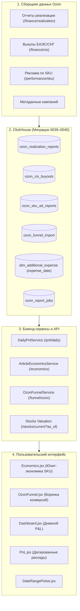
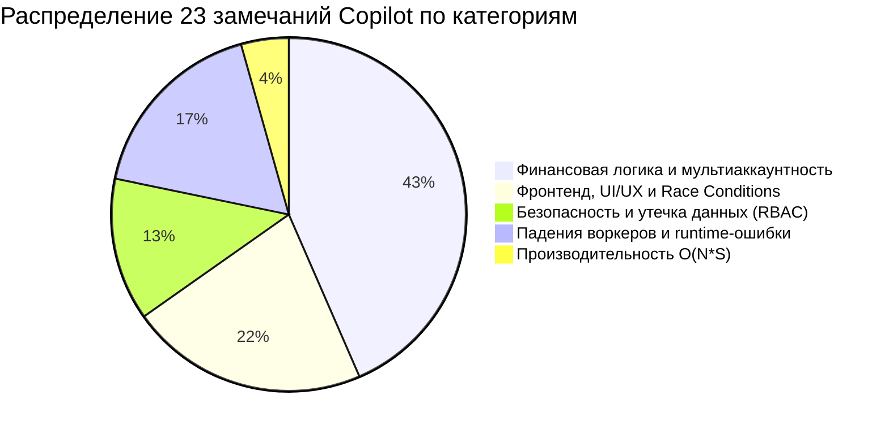

# Полный технический анализ PR #72: Ozon Analytics Customization

> **Pull Request:** [#72](https://github.com/Bormotoon/BormoStats/pull/72)  
> **Заголовок:** `Ozon analytics customization: article economics, funnel and daily P&L`  
> **Автор:** `robertofabiani2003-crypto`  
> **Ветка источника:** `codex/svoyo-upstream-review` $\rightarrow$ `main`  
> **Базовый коммит разработки:** `282a1e0`, адаптирован к upstream `60c79bf`  
> **Статус:** `OPEN (Draft)` — черновик для ревью и обсуждения с мейнтейнером  

---

## 1. Контекст и предыстория

Данный PR представляет собой масштабную доработку функционала BormoStats для реального селлера маркетплейса Ozon. Автор адаптировал платформу под свои боевые процессы финансового и операционного учёта, добавив ряд фундаментальных подсистем, которых ранее в BormoStats не существовало:
- **Потоварную юнит-экономику** с прямой атрибуцией рекламы на уровне артикула (SKU).
- **Воронку конверсий Ozon** с поддержкой ручного импорта отчётов селлера.
- **Ежедневный P&L** с разнесением постоянных/внешних расходов по календарным дням.
- **Расчёт налоговых обязательств** на основе отчётов о реализации и продаж за вычетом возвратов.
- **Историческую оценку складских запасов в деньгах** на произвольную дату (`as_of`).

Автор открыто заявляет в описании PR, что **это черновик (Draft), не готовый к прямому слиянию в `main`**, и предлагает обсудить декомпозицию этого монолитного патча на несколько изолированных PR.

---

## 2. Архитектурная декомпозиция изменений

PR затрагивает бэкенд (FastAPI), базу данных (ClickHouse), фоновые задачи (Celery/Beat), сборщики API Ozon, фронтенд (React/Vite), документацию и скрипты запуска.



### 2.1. Миграции ClickHouse (0039–0045)
- **`0039_ozon_realization.sql`**: таблица `ozon_realization_reports` для хранения строк отчётов о реализации (начисления, комиссии, компенсации, выкупы).
- **`0040_ozon_sku_ad_reports.sql`**: таблица `ozon_sku_ad_reports` для хранения расхода рекламного бюджета с детализацией до конкретного SKU и кампании.
- **`0041_ozon_report_jobs.sql`**: служебная таблица `ozon_report_jobs` для сохранения идентификаторов асинхронных генераций отчётов Ozon (`UUID`) и отслеживания их готовности.
- **`0042_ozon_cis_buyouts.sql`**: фиксация выкупов товаров в странах СНГ/ЕАЭС для отдельного финансового признания.
- **`0043_ozon_funnel_import.sql`**: таблица `ozon_funnel_import` для хранения загруженных пользователем воронок (показы, клики, добавления в корзину по SKU, дням и схемам FBO/FBS).
- **`0044_ozon_campaigns.sql`**: справочник метаданных рекламных кампаний Ozon. Добавлен отсутствовавший ранее откат миграции (`0044_rollback.sql`).
- **`0045_additional_expenses_dates.sql`**: добавление поля `expense_date Nullable(Date)` в витрину `dim_additional_expense`, позволяющее привязывать внешние расходы к конкретному дню, а не только к месяцу.

### 2.2. Сбор данных Ozon (Collectors & Workers)
- В `collectors/ozon/client.py` и `endpoints.py` добавлены методы запроса выкупов СНГ, отчётов о реализации и отчётов Performance API по артикулам.
- В `collectors/ozon/sku_ad_reports.py` реализован пайплайн: заказ отчёта $\rightarrow$ получение `UUID` $\rightarrow$ периодический опрос готовности $\rightarrow$ скачивание и парсинг CSV/JSON $\rightarrow$ сохранение в ClickHouse.
- Сохранено расписание сбора: сбор данных запускается отдельными ежедневными таймерами в 05:00, 05:10 и 05:55 по часовому поясу Celery.

### 2.3. Потоварная юнит-экономика (Article Economics)
- Создан сервис `ArticleEconomicsService` (`backend/app/services/article_economics_service.py`) и общий вычислительный движок `common/article_economics.py`.
- Алгоритм агрегирует продажи, возвраты, начисления маркетплейса, прямые расходы на рекламу SKU, распределяет общие накладные расходы и налог, рассчитывая валовую прибыль, чистую прибыль, рентабельность продаж (ROS), наценку (Markup) и ABC-ранжирование по выручке и марже.
- Реализован экспорт сформированного отчёта в табличные форматы.

### 2.4. Воронка Ozon (Funnel)
- Поскольку Ozon API не отдаёт историческую поднедельную/подневную воронку по всем SKU в удобном виде через API, реализован эндпоинт ручного импорта: `POST /api/v1/funnel/ozon/import`.
- На фронтенде добавлен интерфейс `OzonFunnel.jsx` с загрузкой файлов, парсингом и валидацией, графиками конверсий и таблицами когорт.

### 2.5. Ежедневный P&L и расчет налогов
- `DailyPnlService` (`backend/app/services/daily_pnl_service.py`): формирует ежедневную финансовую картину. Месячные накладные расходы пропорционально разносятся по дням календаря, а расходы с указанной датой относятся строго на свой день.
- `common/pnl_tax.py`: модуль расчёта налога (УСН/НПД). Если включен `PNL_REALIZATION_TAX_ENABLED=true`, налог рассчитывается по базе отчёта о реализации. Если отчёт ещё не закрыт или не полон — налог оценивается по фактической выручке от покупателей за вычетом возвратов.

### 2.6. Оценка склада на дату
- В `stocks.sql` добавлен параметр `%(as_of)s`, позволяющий рассчитать количество и себестоимость остатков на любую историческую дату.

---

## 3. Анализ ревью GitHub Copilot (23 замечания)

Автоматический аудит GitHub Copilot выявил 23 существенные проблемы. Ниже приведён их детальный разбор, сгруппированный по категориям риска.



---

### Группа I. Безопасность и разграничение прав доступа (RBAC)

#### Замечание 1: Утечка себестоимости через эндпоинт воронки
* **Файл:** `backend/app/api/v1/funnel.py:165`
* **Суть проблемы:** Эндпоинт `/funnel/ozon/related` возвращает данные о себестоимости единицы товара (`dim_offer_cost.cost_price_rub`). При этом эндпоинт защищён только `AnalyticsReadAuth`, который разрешён для роли Viewer (и даже для неавторизованных пользователей при публичной аналитике). Официальный эндпоинт себестоимости `/pricing/costs` строго требует `ManagerAuth`.
* **Риск:** Любой рядовой пользователь с правами на просмотр графиков может извлечь закрытую коммерческую информацию о себестоимости и марже поставщика.
* **Решение:** Требовать `ManagerAuth` для ветки `cost` либо исключать себестоимость из ответа, если у пользователя нет прав менеджера.

#### Замечание 2: Утечка себестоимости через остатки склада
* **Файл:** `backend/app/db/queries/stocks.sql:59` (эндпоинт `/stocks/current`)
* **Суть проблемы:** В текущие остатки добавлена оценка склада в деньгах и себестоимость единицы. Эндпоинт защищён `AnalyticsReadAuth`.
* **Риск:** Наблюдатели (Viewers) получают доступ к закрытым данным о закупочных ценах.
* **Решение:** Скрыть поля финансовой оценки за отдельной проверкой прав или вынести оценку остатков в отдельный эндпоинт менеджера.

#### Замечание 20: Поломка дашборда для ролей Viewer и Analyst
* **Файл:** `frontend/src/pages/Dashboard.jsx:128`
* **Суть проблемы:** Базовые KPI дашборда (выручка, количество заказов, график начислений) перевели с общедоступных аналитических эндпоинтов на `/pnl/daily`. Но `/pnl/daily` требует `ManagerAuth`!
* **Риск:** Пользователи с ролями Viewer и Analyst при входе на главный дашборд получают ошибку `403 Forbidden`, и у них перестают работать даже те карточки, которые раньше работали.
* **Решение:** Оставить fallback на стандартные эндпоинты продаж/заказов, если у пользователя нет доступа к P&L.

---

### Группа II. Искажение финансовых расчётов и мультиаккаунтность

#### Замечание 8: Коллизия SKU между разными кабинетами
* **Файл:** `backend/app/services/article_economics_service.py:34`
* **Суть проблемы:** В юнит-экономике словарь товаров формируется по ключу `sku` без учёта `account_id`:
  ```python
  # Проблемный подход:
  cards[sku] = card_data
  ```
  Если у организации подключено 2 кабинета Ozon, где один и тот же SKU продается с разной закупочной ценой или под разными артикулами, последняя запись перезапишет первую. Все продажи обоих кабинетов будут пересчитаны по себестоимости последнего кабинета!
* **Риск:** Сумма COGS и прибыли по каждому отдельному кабинету не сходится с общим отчётом при выборе «Все аккаунты».
* **Решение:** Формировать составной ключ `(account_id, sku)` на всех этапах расчёта до финальной агрегации.

#### Замечание 10: Утечка налога на сторонние кабинеты
* **Файл:** `backend/app/services/article_economics_service.py:78`
* **Суть проблемы:** Налог настраивается строго для одного аккаунта через переменную `PNL_TAX_ACCOUNT_ID`. Однако сервис юнит-экономики вычисляет веса налога по продажам всех выбранных аккаунтов. Если выбраны аккаунт A (облагаемый налогом) и аккаунт B (без налога) с равными продажами, алгоритм спишет 50% налога с аккаунта B.
* **Решение:** Сохранять привязку к кабинету и рассчитывать налог строго внутри целевого `PNL_TAX_ACCOUNT_ID`.

#### Замечания 9, 12, 13, 16: Ошибка границы дат при дедупликации выкупов в СНГ (CIS buyouts)
* **Файлы:**
  - `backend/app/services/article_economics_service.py:56` (Коммент 9)
  - `backend/app/services/daily_pnl_service.py:79` (Коммент 12)
  - `backend/app/services/ozon_cis_service.py:28` (Коммент 13)
  - `backend/app/services/pnl_service.py:259` (Коммент 16)
* **Суть проблемы:** Ozon сначала регистрирует внутреннее отправление (domestic accrual), а позже отражает его как выкуп в ЕАЭС/СНГ. Чтобы продажа не задвоилась, сервис выполняет дедупликацию. Но запрос внутренних начислений ограничен выбранным окном дат!
  - *Пример:* Продажа произошла 30 сентября, а отчёт о выкупе в СНГ пришел 1 октября. Если запросить отчёт за 1–31 октября, продажа 30 сентября не попадает в выборку. Алгоритм считает выкуп 1 октября «новой независимой продажей» и удваивает выручку и налог. Если же запросить период сентябрь–октябрь, дедупликация срабатывает и сумма меняется!
* **Риск:** Финансовые показатели одного и того же дня меняются в зависимости от того, какой интервал дат выбрал пользователь.
* **Решение:** Запрашивать идентификаторы отправлений (`posting_number`) в исторической базе независимо от границ фильтра дат.

#### Замечание 14: Продажи по СНГ с нулевой себестоимостью
* **Файл:** `backend/app/services/ozon_cis_service.py:53`
* **Суть проблемы:** Если по товару, проданному в СНГ, не задана себестоимость, она тихо зануляется (`cogs = 0`), но не инкрементирует счётчик `missing_costs`.
* **Риск:** Товар отображается в дашборде со 100% чистой прибылью, а предупреждение о незаполненной себестоимости не появляется.
* **Решение:** Пробрасывать отсутствие себестоимости в глобальный флаг `missing_costs`.

#### Замечание 15: Не пересчитывается процент маржинальности
* **Файл:** `backend/app/services/pnl_service.py:139`
* **Суть проблемы:** Выручка и валовая прибыль корректируются на выкупы СНГ и факторинг, но поле `margin_pct` возвращается в неизменном виде из исходной витрины.
* **Риск:** Формула `gross_profit / (revenue - returns) * 100` не сходится со значением в карточке отчёта.
* **Решение:** Пересчитывать `margin_pct` на бэкенде после применения всех финансовых оверлеев.

#### Замечание 11: Рассинхронизация статуса налога
* **Файл:** `backend/app/services/article_economics_service.py:115`
* **Суть проблемы:** Если месячный отчёт о реализации загружен, но баланс за месяц ещё не закрыт, `DailyPnlService` переключается на расчет оценочного налога (`estimated`). Юнит-экономика берет сумму из Daily P&L, но оставляет флаг «Подтвержденный налог по отчёту о реализации».
* **Решение:** Копировать статус налога (`tax_status`) вместе с суммой.

#### Замечание 21: Ложный лейбл «После налогов» на дашборде
* **Файл:** `frontend/src/pages/Dashboard.jsx:142`
* **Суть проблемы:** На фронтенде прибыль всегда подписывается «после вычета налогов», даже для Wildberries (где налог не считается) или для Ozon с выключенным налогом (`PNL_REALIZATION_TAX_ENABLED=false`).
* **Решение:** Проверять флаг `tax_enabled` и статус налога, выводя «до налогов» или «налог не рассчитан».

---

### Группа III. Критические ошибки выполнения и падения воркеров

#### Замечание 7: Падение фонового экспорта остатков в CSV
* **Файл:** `backend/app/db/queries/stocks.sql:7`
* **Суть проблемы:** Запрос `stocks.sql` был изменён для поддержки срезов на дату — добавлен обязательный именованный параметр `%(as_of)s`. В HTTP-эндпоинте значение передается. Но этот же SQL-файл используется воркером экспорта в Celery: `workers/app/tasks/exports.py` в функции `build_query_parameters('stocks_current', ...)`. Воркер про параметр `as_of` ничего не знает.
* **Риск:** При нажатии пользователем кнопки «Скачать остатки в CSV» задача падает в Celery с ошибкой `KeyError: 'as_of'`. Экспорт остатков полностью сломан.
* **Решение:** Добавить параметр `as_of` со значением по умолчанию (текущая дата) в билдер параметров фонового воркера.

#### Замечание 17: Вечный цикл ошибок при сборе отчётов Ozon
* **Файл:** `collectors/ozon/sku_ad_reports.py:73`
* **Суть проблемы:** Когда генерация отчёта запрашивается у Ozon, сервис получает `UUID` и сохраняет задачу через `save_job` с пустым `payload`. Если Ozon завершает генерацию с ошибкой (`FAILED`), воркер выбрасывает исключение, но не удаляет задачу из таблицы `ozon_report_jobs`. При этом логика инвалидации очищает только задачи с непустым `payload`.
* **Риск:** При каждом последующем запуске по расписанию воркер берет из базы тот же самый упавший `UUID`, опрашивает Ozon, снова падает и никогда не создает новый запрос. Сбор рекламы по артикулам зависает навсегда.
* **Решение:** Помечать задачи со статусом `FAILED` как терминальные, удалять их или генерировать новый `UUID` при ошибке.

#### Замечания 4 и 5: Сломанные модульные тесты
* **Файлы:** `tests/unit/test_expense_dates.py:95` и `tests/unit/test_pnl_tax_service.py:47`
* **Суть проблемы:** 
  1. В `test_pnl_tax_service.py` мок-база данных падает при вызове `_apply_financing()`, так как мок не ожидал запроса к таблице `mrt_finance_daily`.
  2. В `test_expense_dates.py` тест ожидает старую логику исключения неполных месяцев, в то время как реализация перешла на календарное распределение расходов по дням.
* **Решение:** Обновить моки в тестах и синхронизировать утверждения (`assert`) с новой бизнес-логикой.

---

### Группа IV. Производительность ($O(N \times S)$)

#### Замечание 18: Квадратичная сложность при расчёте начислений
* **Файл:** `common/article_economics.py:52`
* **Суть проблемы:** Движок обработки начислений на каждый шаг обработки отдельной операции вызывает метод `net()`. Метод `net()` проходит циклом по абсолютно всем SKU, накопленным к данному моменту:
  ```python
  for accrual in accruals: # N операций
      before = self.net()  # O(S) суммирование по всем SKU
      self._process(accrual)
      after = self.net()   # O(S) суммирование по всем SKU
  ```
* **Риск:** Сложность алгоритма составляет $O(N \times S)$. При десятках тысяч заказов и сотнях SKU синхронный вызов эндпоинта юнит-экономики или Daily P&L приводит к тайм-ауту HTTP-запроса (504 Gateway Timeout) и блокировке процесса.
* **Решение:** Вести инкрементальный учёт дельты (`running delta`) за $O(1)$ на каждом шаге, а полный пересчёт выполнять ровно один раз в самом конце.

---

### Группа V. Фронтенд, UI/UX и состояние гонки (Race Conditions)

#### Замечание 3: Состояние гонки при смене фильтров дат в PnL
* **Файл:** `frontend/src/pages/PnL.jsx:35`
* **Суть проблемы:** В `useEffect` при изменении диапазона дат запускаются асинхронные запросы без проверки актуальности (`ignore flag` или `AbortController`). Если пользователь быстро кликнул «Прошлый месяц», а затем «Текущий месяц», ответ за прошлый месяц может прийти позже и перезаписать состояние.
* **Риск:** Заголовок страницы показывает «Ноябрь», а в карточках отображаются финансовые цифры за «Октябрь».
* **Решение:** Использовать флаг очистки эффекта `let active = true; ... return () => { active = false; };`.

#### Замечание 23: Отсутствие реактивности при создании расхода
* **Файл:** `frontend/src/pages/PnL.jsx:66`
* **Суть проблемы:** Коллбэк `onSaved` в компоненте `ExpenseForm` добавляет новый расход только в локальный массив списка расходов `expenses`. Но карточки верхнего уровня (общие внешние расходы, чистая прибыль) берут данные из состояния `daily`!
* **Риск:** Пользователь вносит расход на 50 000 ₽. Строка появляется в таблице, но прибыль наверху не уменьшается до полной ручной перезагрузки страницы по F5.
* **Решение:** Вызывать рефетч (`refetchDaily()`) после успешного сохранения расхода.

#### Замечание 22: Смешивание суточных и месячных затрат
* **Файл:** `frontend/src/pages/PnL.jsx:55`
* **Суть проблемы:** Таблица структуры затрат (логистика, хранение, комиссии) берет данные из месячного P&L, а налоги и реклама в этой же таблице берутся из суточного диапазона (`daily`). При выборе 1 дня получается абсурд: логистика за весь месяц, а реклама за 1 день.
* **Решение:** Разделять подневную аналитику и месячную структуру затрат.

#### Замечание 19: Ложные нули при отсутствии данных
* **Файл:** `frontend/src/pages/Dashboard.jsx:79`
* **Суть проблемы:** `DailyPnlService` генерирует массив на каждый день диапазона даже при полном отсутствии строк в базе. Фронтенд считает, что если массив не пуст, значит прибыль успешно рассчитана, и рисует «0 ₽».
* **Решение:** Возвращать с бэкенда метаданные о наличии данных (`has_data: false`) и показывать пользователю плашку «Данные отсутствуют».

#### Замечание 6: Недетерминированная пагинация воронки
* **Файл:** `backend/app/api/v1/funnel.py:101`
* **Суть проблемы:** В запросе `SELECT ... ORDER BY day, sku, scheme LIMIT ... OFFSET ...` отсутствует `account_id`. В отчёте по всем аккаунтам строки с одинаковыми `(day, sku, scheme)` могут произвольно переставляться на границе страниц ClickHouse.
* **Риск:** При экспорте или постраничном просмотре строки дублируются или теряются.
* **Решение:** Добавить `account_id` в секцию `ORDER BY`.

---

## 4. Рекомендованный план действий (Roadmap интеграции)

Попытка замержить PR #72 целиком приведёт к деградации стабильности проекта. Рекомендуется разделить доработки на **4 последовательных PR**:


### Этап 1. Сборщики данных Ozon и схема БД
1. Выделить миграции `0039`–`0042`, `0044` (с обязательным rollback-скриптом).
2. Перенести сборщики отчётов о реализации, выкупов СНГ и рекламы по SKU.
3. **Исправить баг Copilot #17:** добавить корректную инвалидацию/перезапуск упавших `UUID` задач генерации отчётов Ozon.
4. Добавить параметр `as_of` в билдер воркера экспорта остатков (`workers/app/tasks/exports.py`), закрыв **баг Copilot #7**.

### Этап 2. Датированные расходы, остатки на дату и Daily P&L
1. Выделить миграцию `0045` (`expense_date`).
2. Добавить API датированных расходов и форму `ExpenseForm.jsx` с фиксом реактивности (**Copilot #23**).
3. Добавить сервис `DailyPnlService` с исправлением дедупликации выкупов СНГ по историческим заказам (**Copilot #12, #13, #16**).
4. Защитить эндпоинты: оставить fallback для ролей Viewer/Analyst на дашборде (**Copilot #20**).
5. Добавить флаг отмены запросов в `PnL.jsx` (**Copilot #3**).

### Этап 3. Потоварная юнит-экономика (Article Economics)
1. Вынести движок юнит-экономики и страницу `Economics.jsx`.
2. **Оптимизировать алгоритм:** заменить вызов `net()` на каждом шаге на инкрементальную дельту $O(1)$, ликвидировав квадратичную сложность $O(N \times S)$ (**Copilot #18**).
3. Обеспечить строгую изоляцию аккаунтов по ключу `(account_id, sku)` (**Copilot #8**).
4. Закрыть доступ к себестоимости для непривилегированных ролей (**Copilot #1, #2**).

### Этап 4. Воронка Ozon (Funnel)
1. Выделить миграцию `0043` (`ozon_funnel_import`).
2. Добавить эндпоинты импорта и страницу `OzonFunnel.jsx`.
3. Добавить `account_id` в сортировку ClickHouse для детерминированной пагинации (**Copilot #6**).
4. Проверить ролевые ограничения на загрузку и просмотр данных.

---

## 5. Заключение

PR #72 — чрезвычайно полезная инициатива от внешнего разработчика-практика, закрывающая ключевые пробелы BormoStats (потоварная юнит-экономика, реклама по SKU, суточный P&L). Однако текущее состояние кода требует существенной доработки безопасности, оптимизации алгоритмов и исправления дефектов расчёта мультиаккаунтности. Рецензия GitHub Copilot оказалась исключительно качественной и полностью совпадает с реальными уязвимыми местами предложенного патча.

